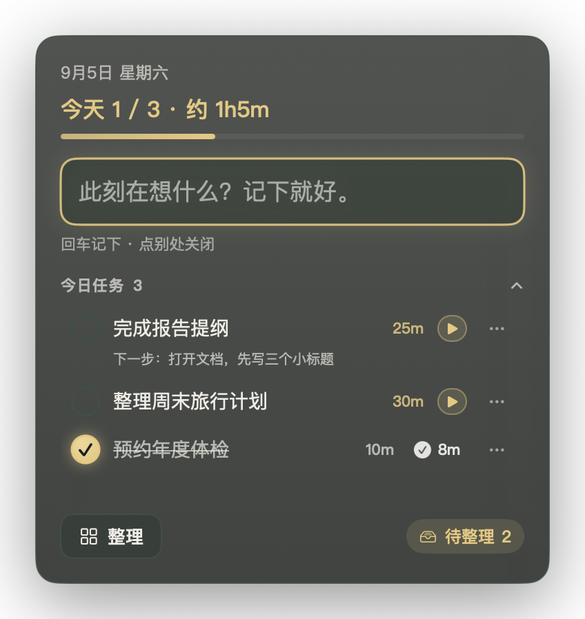

# Pare

**把脑中的事卸下来，挑出今天最重要的一件。没动力时，先做 5 分钟。**

Pare 是一个常驻 macOS 菜单栏的小工具：随手记下念头，用四象限理清轻重，再把计划变成一个能开始的小动作。

无需账号 · 本地存储 · 核心功能离线可用 · 可选的注意力漂移提醒

[安装](#安装) · [30 秒上手](#30-秒上手) · [详细使用指南](docs/guide.md)


*今天只赢一件：先选定重点，再给自己一个小到能开始的动作。以下均为真实界面截图，内容为虚构演示任务。*

## 30 秒上手

1. **记下来。** 点击菜单栏图标，或按 `⌥Space`，写下「完成报告提纲」，回车保存。
2. **归个位。** 点「整理」，把它拖进合适的象限；点太阳图标加入今天。
3. **挑一件。** 打开「今日计划」，点星标选出今天最重要的一件。
4. **开始一点。** 在任务「…」里把下一步写成「打开文档，先写三个小标题」，再点「开始 5 分钟」。还不想动，就点「我卡住了」。

不需要先把所有任务都整理完，选好一件就可以开始。

## 念头来了，几秒钟记下

一条待办、一个突然冒出的想法，都可以先放进来。回车记下，点别处收起；不用离开手头的工作去整理整份清单。

<p align="center">
  
</p>

支持本地解析简单的提醒语句，例如 `30分钟后提醒我喝水`。不急着做的念头，也可以保留为「想法」，以后再回看。

## 看清轻重，给今天留点余地

四象限让重要和紧急分开考虑；「今日计划」只放今天打算推进的事。可以调整顺序、估算用时，安排过多时会收到温和提示。


任务的「…」里可以写下一步、完成标准和备注，设置截止日期与提醒。截止日期告诉你什么时候要完成，提醒决定什么时候叫你一声。

## 卡住的时候，从更小的一步开始

「我卡住了」会让你选一选：不知道下一步、任务太大、没有精力，还是有压力或抗拒。随后写下最小下一步与最低完成版本，也可以换做今天较短的一件事。

<p align="center">
  
</p>

五分钟到点后，可以从通知中选择继续、暂停或完成。停止计时后，即使任务还没完成，这一段投入也会保留下来；今日小结会记录启动次数、推进过的任务和卡点。

## 在合适的时候，提醒你一下

- **每天的节奏：** 早上规划、晚上收尾，以及本周回顾；时间和开关都能调整。
- **具体的启动约定：** 例如「如果到了 9:30，那么打开文档写三个小标题」。也可以选择回到电脑或切换到某个应用时提示。
- **注意力漂移：** 可选检测应用或浏览器页面的快速往返，提示你是否要先推进今日关键任务五分钟。可调整频率，或忽略一小时。

切换页面也可能是在正常查资料。Pare 只提供一个可忽略的提示，不能判断你是否在认真工作。浏览器检测需要单独开启并授权；[查看工作方式与隐私说明](docs/guide.md#注意力漂移与隐私)。

## 安装

目前通过源码构建使用。需要 macOS 13 及以上、Swift 6 工具链；当前构建流程在 Apple Silicon Mac 上验证。

```bash
git clone https://github.com/Zita-Go/Pare.git
cd Pare
./build_app.sh
open dist/Pare.app
```

如果尚未安装命令行开发工具，先运行 `xcode-select --install`。构建成功后，把 `dist/Pare.app` 拖到「应用程序」文件夹即可长期使用。启动后在屏幕顶部的菜单栏找到 Pare 图标。

首次引导中可开启系统通知；右键菜单栏图标 →「提醒设置…」可以修改随手记快捷键、设置登录时自动启动、提醒时间和数据备份。默认快捷键为 `⌥Space`，点击设置顶部的快捷键框、按下新组合即可立即生效。普通记事和全局快捷键不需要辅助功能权限。

## 你的内容，留在你的电脑上

Pare 不需要登录，任务、想法和专注记录保存在本机。应用不上传这些内容；可选浏览器检测也不保存标题、网址或浏览历史。

每次保存保留上一份自动备份，设置里可以导出和恢复数据。每天翻篇时，已完成任务进入历史，未完成任务仍留在四象限，今日选择重新开始。

[使用指南与常见问题](docs/guide.md) · [开发、测试与截图方法](docs/development.md)
