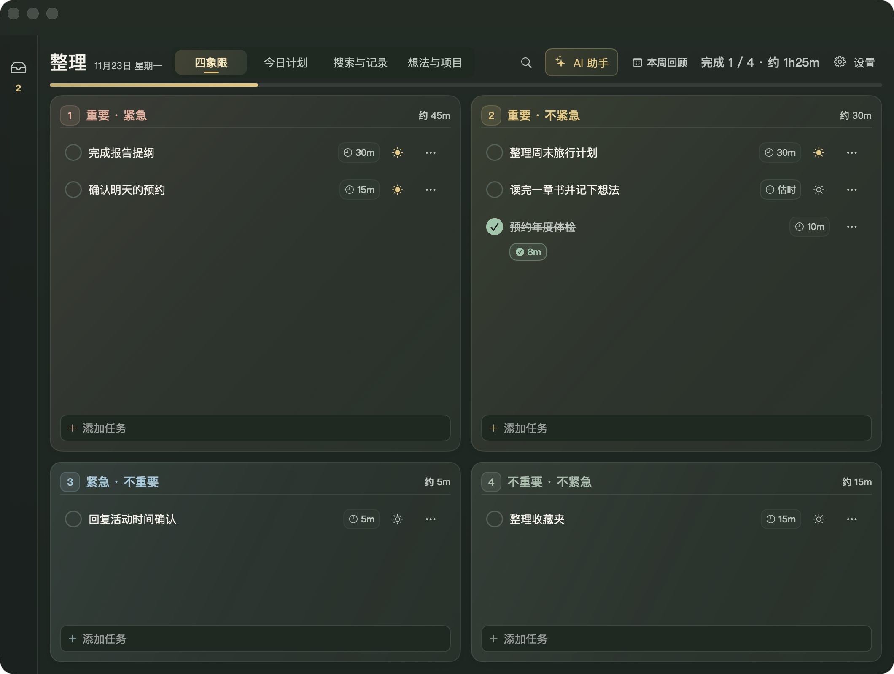
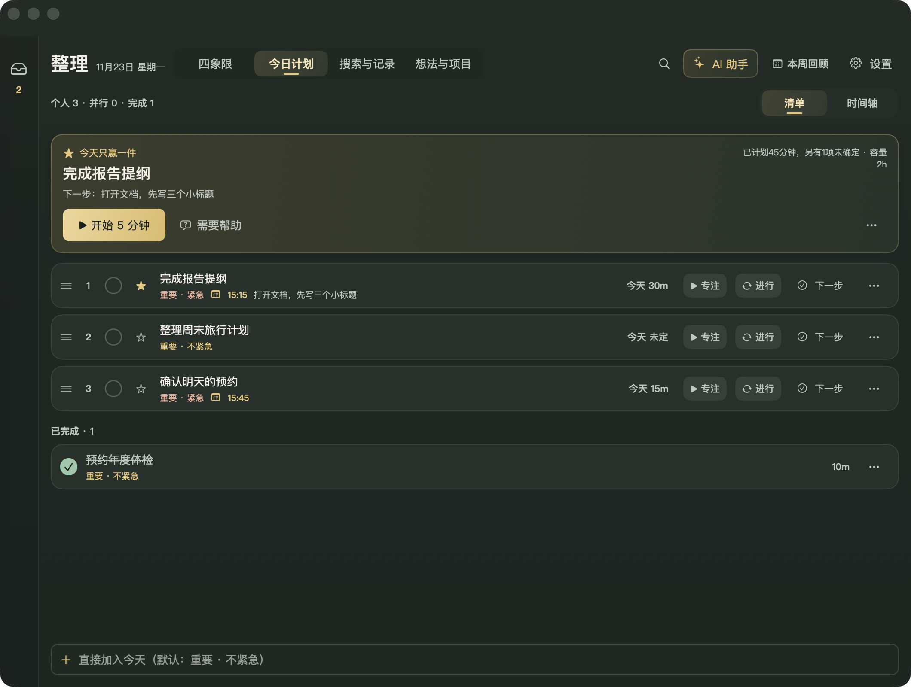
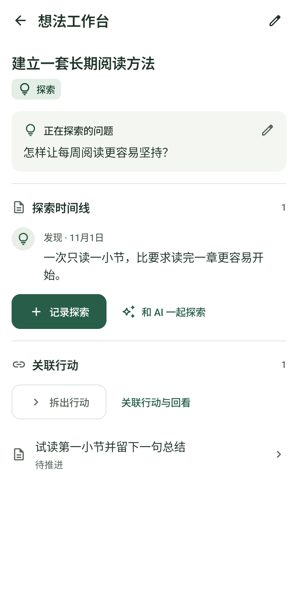
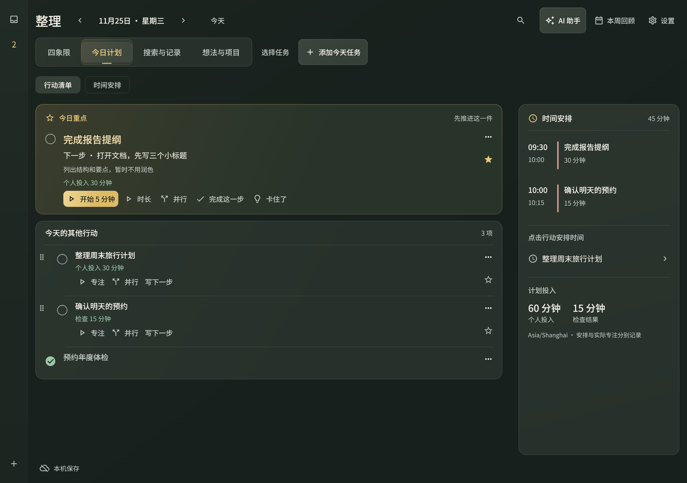

  

<h1 align="center">Step</h1>

<strong>把想法变成下一步，一步一步完成。</strong>

四象限做取舍 · 想法慢慢成形 · 今天从一件小事开始

  <a href="https://github.com/Zita-Go/Pare/releases/download/v2.16.0/Step-2.16.0-macos-arm64.zip"><strong>下载 Mac 版</strong></a>
  &nbsp; / &nbsp;
  <a href="https://github.com/Zita-Go/Pare/releases/download/windows-v0.4.0/Step-0.4.0.exe"><strong>下载 Windows 版</strong></a>
  &nbsp; / &nbsp;
  <a href="https://github.com/Zita-Go/Pare/releases/download/v2.16.0/Step-0.15.0-android-debug.apk"><strong>下载安卓版</strong></a>

无需先注册账号或配置 AI，打开就能在本机记下想法、规划今天。

  

先分清轻重，再挑出今天值得推进的几件事。图片均使用演示资料，点击可查看原图。

<a href="#开始使用">开始使用</a> · <a href="#从想法到行动">功能介绍</a> · <a href="#换设备接着做">账号同步</a> · <a href="#安装与常见问题">安装帮助</a>

## 开始使用

| 设备 | 下载与版本 | 第一次打开 |
| :--- | :--- | :--- |
| **Mac** Apple Silicon · macOS 13+ | [下载 2.16.0](https://github.com/Zita-Go/Pare/releases/download/v2.16.0/Step-2.16.0-macos-arm64.zip) · [版本说明](https://github.com/Zita-Go/Pare/releases/tag/v2.16.0) | 解压后将 `Step.app` 拖入「应用程序」。点菜单栏图标或按 **⌥Space** 随手记，再点「整理」。 |
| **Windows** Intel / AMD x64 · Windows 10/11 | [下载 0.4.0](https://github.com/Zita-Go/Pare/releases/download/windows-v0.4.0/Step-0.4.0.exe) · [版本说明](https://github.com/Zita-Go/Pare/releases/tag/windows-v0.4.0) | 安装后打开 Step。按 **Ctrl+Shift+Space** 随手记，在四象限归类，再加入今天。 |
| **Android** Android 8.0+ | [下载 0.15.0](https://github.com/Zita-Go/Pare/releases/download/v2.16.0/Step-0.15.0-android-debug.apk) · [版本说明](https://github.com/Zita-Go/Pare/releases/tag/v2.16.0) | 安装 APK 后打开 Step，在「整理」中记下想法，或在「今天」直接添加任务。 |

**先走完这三步，就可以开始了：**

1. **记下一件事。** 不用先整理完整清单，写一句话也可以。
2. **选进今天。** 在四象限分清轻重，挑出今天要推进的事，再选一件重点。
3. **写下一个小动作。** 把“完成报告”变成“打开文档，写三个标题”。先做五分钟，做完点「完成这一步」。

> 更新前请先备份、保存输入并退出旧版。[查看安装帮助](#安装与常见问题)

## 从想法到行动

### 分清轻重，也留出余地

四象限帮你区分**重要**与**紧急**，今日计划帮你决定有限精力用在哪里。没有加入今天的任务会继续保留，不必每天面对整份清单。

平时用清单看清当天的行动，需要排时间时再切到时间轴，拖动安排开始时间和时长。

  

Mac · 今日计划：先看重点，再决定接下来做什么。

### 做完一步，再向前一步

长期任务可以按 **写下一步 → 完成这一步 → 再写下一步** 推进。Step 保留每一步的内容、完成时间和完成标准；完成一步后，主任务继续保留，已有计时与安排不会被自动结束，误点也可以撤销。

没动力时，用「我卡住了」把动作缩小，写清“做到哪里就可以停”。可以只保存，也可以开始一小段专注。

### 让想法慢慢长成项目

一个还不成熟的方向，可以先留作想法。记录正在探索的问题，补充发现和决定，准备好时再拆出具体行动；原想法与关联任务始终保持联系。

<table>
  <tr>
    <td align="center" width="50%"><strong>看清今天</strong> 今日重点与行动清单</td>
    <td align="center" width="50%"><strong>继续完善一个想法</strong> 问题、发现与关联行动</td>
  </tr>
  <tr>
    <td align="center"></td>
    <td align="center"></td>
  </tr>
</table>

Android · 保留图片原始比例，展示完整应用页面。

### 自己推进，也记得回来检查

事情交给其他 AI、机器或别人处理时，可以记录等待状态，提醒自己回来检查。**个人专注与等待分开记录**，不会把等待时间算成你的投入；Step 不会接管外部 AI。

<strong>看看 Windows 的今日界面</strong>

  

Windows 界面图使用真实应用组件和演示资料，以 2 倍像素密度渲染；不包含系统窗口边框。[查看 Windows 功能与操作说明](docs/guide-windows.md)

## 换设备接着做

在 Mac、Windows 和 Android 上登录同一个 **Step 同步账号**。首次连接时查看合并内容，确认后开启同步；之后离线修改先留在本机，联网后继续同步。有冲突时，可以比较两个版本再决定。

| Mac | Windows | Android |
| :--- | :--- | :--- |
| 设置 → 同步 | 设置 → 账号与同步 | 更多 → 账号与同步 |

任务、想法、目标、计划和步骤历史可以随账号同步。**换设备前，先确认原设备同步成功。** 正在进行的计时不会跨设备接续，通知权限与 AI 连接需要在各设备单独配置。

## AI 帮你思考，由你决定

配置自己的模型服务后，可以让 AI 帮你找下一步、整理想法或安排今天。你选择参考内容，查看建议，再决定采纳哪些修改。

- 需要时才生成建议，本地轻提示不会自动调用模型。
- 可以按需参考长期目标、规划偏好与相关记录。
- 采纳前查看修改；AI 不会自动替你完成任务或启动计时。

[Mac AI 操作详解](docs/guide.md#ai-辅助) · [Windows 使用说明](docs/guide-windows.md)

## 数据与隐私

| 你的选择 | 内容如何保存 |
| :--- | :--- |
| **只在本机使用** | 任务、想法和计划保存在本机，无需账号。 |
| **开启账号同步** | 本机仍保留内容，同步成功后云端也保存一份。 |
| **主动使用 AI** | 你确认发送的参考内容交给所配置的模型服务，与账号同步分开。 |

模型密钥、AI 原始请求历史、快捷键和设备设置留在各自设备。跨设备运行状态共享需要另行开启，只供参考，不能远程控制计时。

同步使用加密连接与账号隔离，**不是端到端加密**。同步也不能代替独立备份，重要内容请另外导出留存。[了解同步范围与备份方法](docs/guide.md#同步与数据保存)

## 安装与常见问题

<strong>Mac 提示无法打开，或要求钥匙串授权</strong>

当前 Mac 安装包尚未经过 Developer ID 签名和 Apple 公证。请从本仓库下载，按系统提示处理，并可用发布页的[校验文件](https://github.com/Zita-Go/Pare/releases/download/v2.16.0/Step-SHA256SUMS.txt)核对内容。首次读取已保存的账号或模型凭据时，可能要求在系统窗口完成钥匙串授权，不要把本机密码发给他人。

<strong>Windows 安装时显示未识别发布者</strong>

当前安装包尚无商业代码签名。请从 [Windows 发布页](https://github.com/Zita-Go/Pare/releases/tag/windows-v0.4.0)下载，可选择 EXE、MSI 或免安装 ZIP，并用同页的 `SHA256SUMS.txt` 核对文件。兼容性与验收范围详见版本说明。

<strong>Android 无法覆盖安装，或没有收到提醒</strong>

当前 APK 使用测试签名，尚未完成物理手机验收。若与已安装版本签名不同，可能无法直接覆盖；请先备份，不要为了安装而直接卸载旧版。提醒需要系统通知权限，后台提醒与同步还可能受手机省电设置影响。

<strong>关闭应用后，还会提醒吗？</strong>

Mac 可以关闭主窗口并保留菜单栏应用；Windows 可以保留系统托盘，退出后提醒需在「设置 → Windows」单独开启。电脑关机、未登录或系统关闭通知时，不能保证收到提醒。Android 需允许通知，并留意系统的后台与省电限制。

<strong>旧版 Pare 可以升级吗？</strong>

可以。Step 是 Pare 的新名称，沿用原有账号和资料库。更新前先导出备份并正常退出旧版；资料库升级后，回退旧版需配合恢复升级前的备份。避免同时运行新旧两份应用。

---

<strong>不用一次做好全部。先找到能开始的那一步。</strong>

<a href="docs/guide.md">Mac 使用指南</a> · <a href="docs/guide-windows.md">Windows 使用指南</a> · <a href="https://github.com/Zita-Go/Pare/releases">全部下载</a> · <a href="https://github.com/Zita-Go/Pare/issues">反馈问题</a>

