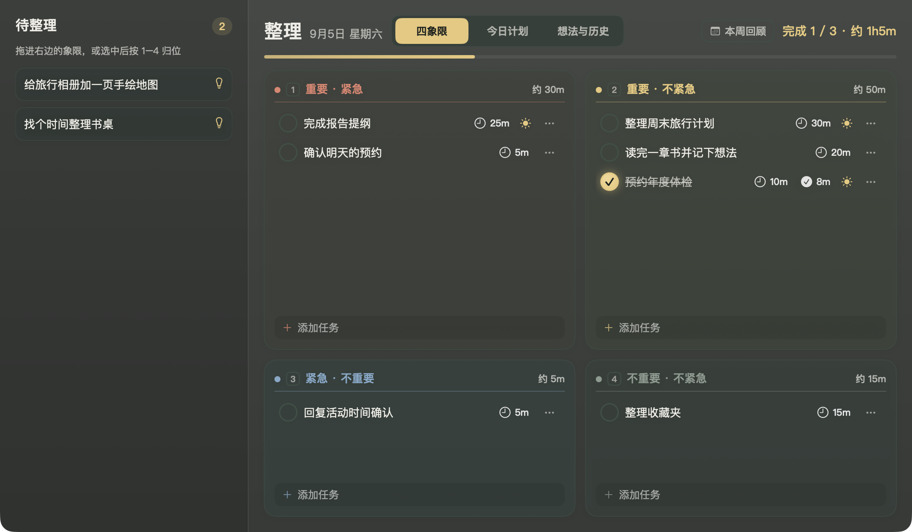
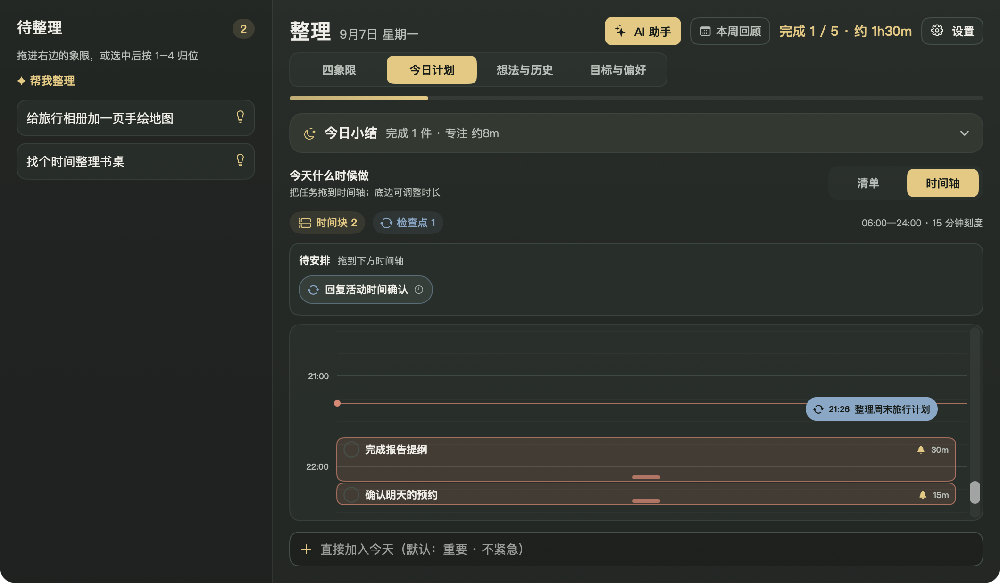
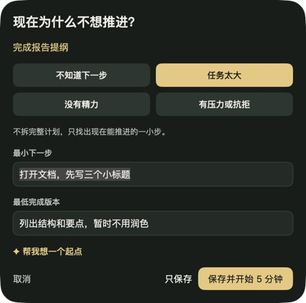
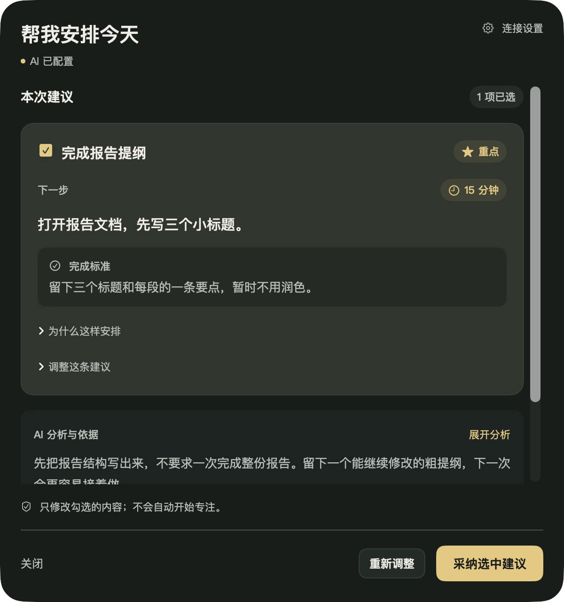
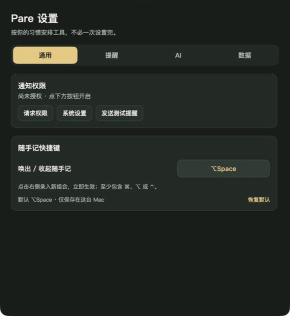

<p align="center">
  
</p>

<h1 align="center">Pare</h1>

<p align="center"><strong>把脑中的事放下来，选出今天的一件事。没动力时，先做 5 分钟。</strong></p>

<p align="center">
  macOS 13+ · Apple Silicon · 本地优先 · 无需账号 · AI 可选
</p>

<p align="center">
  <a href="https://github.com/Zita-Go/Pare/releases/download/v2.7.1/Pare-2.7.1-macos-arm64.zip"><strong>下载 Pare 2.7.1（预发布）</strong></a>
  · <a href="#一分钟开始使用">开始使用</a>
  · <a href="docs/guide.md">完整指南</a>
</p>

Pare 是一个常驻 macOS 菜单栏的个人规划工具。念头出现时先记下，需要行动时再分清轻重、挑出今天真正要推进的事，并把它缩小成一个可以立刻开始的动作。


<p align="center"><em>截图来自 2.7.0 原生界面，内容均为隔离的虚构演示任务。</em></p>

> 不必先整理完人生。先选一件，开始一点。

## Pare 能帮你什么

| 当你遇到…… | Pare 提供…… |
| --- | --- |
| 脑中事情太多，怕忘又不想被打断 | 用 `⌥Space` 唤出随手记，回车保存 |
| 清单很长，不知道先做什么 | 用四象限分清重要与紧急，只挑少量任务进入今天 |
| 今天的任务总被继续往后推 | 切到时间轴，把任务放进一个明确的开始时间 |
| 知道该做，却迟迟开始不了 | 写下最小下一步，或直接开始 5 分钟 |
| 在应用和页面之间反复切换 | 可选的注意力提示，提醒你停一下并回到重点 |
| 想让计划参考长期目标和过去反馈 | 可选 AI 草稿助手；你控制参考范围并决定是否采纳 |

## 一分钟开始使用

1. **记下来：** 点击菜单栏 Pare 图标，或按 `⌥Space`，输入一句话并回车。
2. **分清轻重：** 打开「整理」，把待整理内容拖进四象限。
3. **选择今天：** 点任务旁的太阳，在「今日计划」里选出“今天只赢一件”。
4. **降低门槛：** 写一个 5–15 分钟能完成的下一步，然后点「开始 5 分钟」。
5. **需要时再排时间：** 在今日计划切到「时间轴」，拖入任务或单击选择开始时间。

不需要每天使用所有功能。只用“随手记 → 今日重点 → 开始五分钟”，Pare 就已经能发挥作用。

源码中的 2.10.1 候选版包含「想法与项目」和情境 AI 助手，并简化了日常操作：先看到下一步，再采纳；参考范围与反馈按需展开，采纳可撤销。本地轻提示只在你主动生成后才请求模型。当前公开下载仍为上方的 2.7.1 预发布版；[查看 2.10.1 本地候选说明](docs/releases/v2.10.1.md)。

## 念头来了，先放下来

随手记只做一件事：快速接住此刻的想法。它不会要求你立刻分类，也不用离开正在做的工作。

<p align="center">
  
</p>

- 点击菜单栏图标或按 `⌥Space` 打开，再按一次收起。
- 回车保存；输入框会在每次打开时自动聚焦。
- 支持 `30分钟后提醒我喝水` 这类简单时间表达。
- 暂时不需要行动的内容可以保留为「想法」。
- 今日任务可直接开始／暂停个人专注，或标记为可同时推进的并行任务。

## 看清轻重，但不给今天塞满

四象限负责整理，今日计划负责取舍。任务可以设置下一步、完成标准、估时、截止日期和提醒；“加入今天”与任务所在象限彼此独立。

已有任务可以直接拖到其它象限；右键“移到其它象限”和选中后按数字键 `1–4` 也能完成同一操作。



Pare 会在今日任务过多或估时过满时给出温和提示，但不会阻止你继续安排。每天翻篇后，完成项进入历史，未完成任务留在原象限，今天的选择重新开始。

## 从清单变成今天的时间

「今日计划」内部可以在 `清单 / 时间轴` 间切换，不会多出一个顶层页面。把待安排任务拖到 15 分钟刻度，或单击任务直接选择开始时间；时间块采用任务预估，拖动底边即可调整时长。



时间重叠会提示但不会强制阻止。时间块默认提前 5 分钟提醒，可改为准时、提前 15 分钟或关闭；通知可开始专注、延后或完成。并行任务只显示检查点，不占用你的个人时间。

## 没动力时，不要求自己完成

点击「我卡住了」，选择更接近此刻的原因：不知道下一步、任务太大、没有精力，或有压力与抗拒。Pare 会让你只写“现在能做的一小步”和“做到哪里就可以停”。

<p align="center">
  
</p>

你可以只保存，也可以立刻开始五分钟。停止计时后，即使任务尚未完成，这一段投入仍会被记录；回顾关注的是“有没有启动和推进”，不只统计打勾数量。

## AI 是草稿助手，决定权仍在你

AI 默认关闭。你可以在「设置 → AI」连接兼容的云端 API 或本机模型服务。日常使用只需选择本次可用时间，点击「帮我安排」，再检查和采纳建议。

<p align="center">
  
</p>

AI 可以：

- 给选中的任务想一个具体起点；
- 把待整理内容建议为任务或想法；
- 在给定时间内安排一项重点和少量备选；
- 在你明确允许后，参考近 7／30 天统计、长期目标、偏好和过去反馈。

2.10.0 新助手还可从想法详情「接着想一想」，查看前情、关键未知和一次最小探索；按项采纳为关联行动、下一问题或带 AI 来源的探索记录。今日规划显示整天已计划的投入与未确定项；「我卡住了」提供 2–5 分钟起点。确认偏好位于「设置 → AI」，可以改写或忘记。本地轻提示不会自行请求模型。

每次请求都会显示参考范围；详细内容可在「调整」中选择和预览。模型结果先通过任务对应、数量、字段和时间预算检查，**不会自动写入任务，也不会自动开始专注**。超预算或格式错误只显示原因和只读参考，需要你手动重试。

这是受控的规划工作流，不是无人值守的通用 Agent：它不会执行终端命令、操作其它 App，或在后台自行反复调用 API。[查看 AI、长期目标与隐私说明](docs/guide.md#ai-辅助)。

## 提醒你，而不是监督你

- 早晨规划、傍晚收尾与每周回顾；时间和开关都可调整。
- 单个任务可设置截止时间、一次或重复提醒。
- 可创建“如果到了某个时间／回到电脑／打开某个应用，就提醒我做某一步”的启动约定。
- 可选检测短时间内的应用往返；浏览器增强模式只在内存中使用标题散列，不保存标题、网址或浏览历史。

页面切换也可能是正常研究。Pare 的注意力提示可以忽略、暂停一小时或完全关闭；它不能判断你是否认真工作。

## 设置不需要到处找

主窗口右上角「设置」或 `⌘,` 会打开统一设置页：

- **通用：** 通知权限、测试提醒、随手记快捷键；
- **提醒：** 每日节奏、注意力漂移和规划边界；
- **AI：** 模型连接、本地历史与背景；
- **数据：** 登录启动、导出、导入和自动备份。

<p align="center">
  
</p>

## 安装

当前提供 **Apple Silicon（M 系列）预发布版**，需要 macOS 13 或更高版本。

1. 下载 [Pare-2.7.1-macos-arm64.zip](https://github.com/Zita-Go/Pare/releases/download/v2.7.1/Pare-2.7.1-macos-arm64.zip)。
2. 可用 [SHA256SUMS.txt](https://github.com/Zita-Go/Pare/releases/download/v2.7.1/SHA256SUMS.txt) 核对文件。
3. 解压后，把 `Pare.app` 拖入「应用程序」文件夹，再从那里启动。
4. 首次打开后，在「设置 → 通用」开启通知并发送测试提醒。

更新前建议在「设置 → 数据」导出备份，退出旧版后再替换 App。为让通知中心稳定识别图标，请不要长期从下载目录、源码目录的 `dist` 或其它临时路径运行。

### macOS 拦截打开时

当前安装包尚未使用 Developer ID 签名和 Apple 公证。请确认文件来自本仓库并核对 SHA-256，然后在 Finder 中右键 Pare，选择「打开」。[查看 2.7.1 版本说明](docs/releases/v2.7.1.md)。

## 你的内容由你控制

- 核心功能无需账号，任务、想法、计时和偏好保存在本机。
- 不开启 AI 时不会把任务发送给模型服务。
- 云端 AI 只接收你在发送预览中选择的内容；服务商自身的数据政策另行适用。
- API Key 按接口地址保存在 macOS 钥匙串，不进入任务备份或仓库。
- 设置可以导出备份；每次保存还会保留上一版本的自动备份。

## 当前预发布限制

- 安装包仅提供 Apple Silicon 版本。
- 尚未经过 Developer ID 签名和 Apple 公证。
- 浏览器增强提醒、通知动作及实际休眠／唤醒仍在继续做端到端验收。
- 注意力提醒是启发式辅助，不适合作为生产力评判或监控工具。

## 从源码构建

需要 macOS 13 及以上和 Swift 6 工具链：

```bash
git clone https://github.com/Zita-Go/Pare.git
cd Pare
./build_app.sh
open dist/Pare.app
```

长期使用时仍应把构建得到的 `Pare.app` 拖入「应用程序」。

[完整使用指南](docs/guide.md) · [2.7.1 版本说明](docs/releases/v2.7.1.md) · [开发与截图方法](docs/development.md) · [发布验收记录](Tests/RELEASE_ACCEPTANCE.md)
