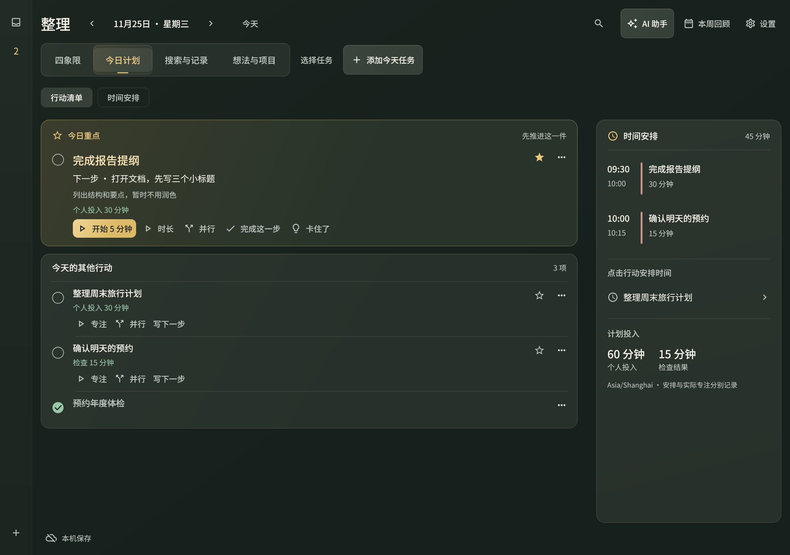
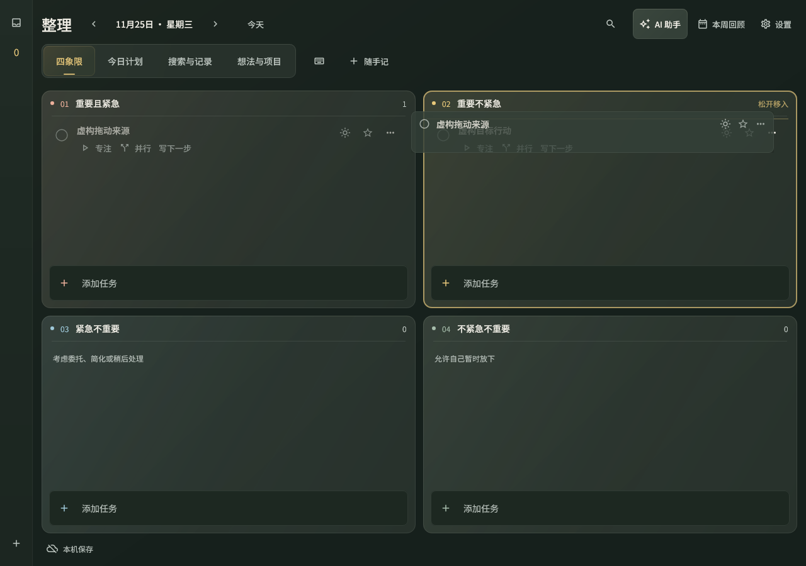

# Step Windows 使用指南

[返回首页](../README.md) · [下载 0.4.2 与版本说明](https://github.com/Zita-Go/Pare/releases/tag/windows-v0.4.2)

先记下一件事，分清轻重，再找到一个能开始的小动作。无需先注册账号或配置 AI。

## 先认识主窗口

顶部四个页面分别负责不同的事情：

| 页面 | 适合做什么 |
| --- | --- |
| **四象限** | 按重要与紧急整理任务，选择哪些值得加入当天计划 |
| **今日计划** | 选定一天的重点，查看行动清单，安排具体时间 |
| **搜索与记录** | 搜索内容，查找已完成、归档及回收站中的事项 |
| **想法与项目** | 保存早期方向、探索记录与关联行动；从这里进入长期目标 |

左侧是「待整理」，点收件箱图标展开或收起。右上角可以进入 AI 助手、本周回顾和设置。

## 随手记：先把想法放下来

Step 运行时，按 **Ctrl+Shift+Space** 打开随手记，也可以从主窗口或托盘菜单进入。

1. 写一句话，按 **Enter** 或 **Ctrl+Enter** 保存到待整理。
2. 保存成功后输入框清空，面板继续打开，可以接着记下一件。中文输入法正在选词时，先确认候选字，再回车保存。
3. 按 **Esc**、点「取消」或关闭窗口收起面板；同一次运行中再次打开，未保存的文字仍会保留。退出 Step 前请保存草稿。

面板下方可以查看今日任务，也会显示未加入今天的进行中事项。列表可滚动；点「今日任务」收起或展开。点击任务标题或「…」可编辑详情，任务旁可直接专注、暂停、继续、记录并行状态或完成下一步。点底部「整理」进入主窗口。

当前点击其他应用不会自动收起随手记，需要用 Esc 或窗口里的关闭操作。

## 四象限：整理与快速添加

在每个象限底部的「添加任务」输入框写下名称，按 **Enter** 创建。任务保存成功后才清空输入；切换页面再回来，同一次运行中的未保存草稿仍在。

**象限内添加只负责创建任务，不会自动加入当天计划。** 想安排某一天，再点任务旁的太阳图标。

待整理里的内容可以点 **1–4** 归入象限，也可以「留作想法」。直接按住任务文字或空白区域，在象限之间移动或调整顺序。拖动时会显示跟随鼠标的半透明任务预览，来源任务变淡，目标象限用原有颜色的细边框提示落点；按 Esc 可取消，移动后可撤销。完成、星标、太阳和「…」等按钮仍独立响应点击。很矮的窗口支持滚动查看下排象限，拖到视口底边也会滚动。右键菜单仍提供移动入口。

需要改标题、估时、下一步、截止或提醒时，点任务旁的「…」打开详情。

查看拖动时的提示

### 用键盘整理

在四象限顶部点键盘图标，将焦点交给整理区域：

| 按键 | 作用 |
| --- | --- |
| **↑ / ↓** | 选择待整理内容或任务；展开待整理后，它也会进入选择范围 |
| **1 / 2 / 3 / 4** | 将选中内容归入对应象限，或移动已有任务 |
| **Space** | 完成选中的整项任务；保持选中时再按一次可恢复 |
| **Esc** | 取消当前选择 |
| **Ctrl+F** | 打开「搜索与记录」，直接输入搜索词 |

输入框编辑时，方向键、数字和空格继续用于输入，不会被当成整理指令。

## 今日计划：先选日期，再选行动

「今日计划」和「四象限」共享顶部的规划日期。点日期两侧按钮切换日期，点「今天」回到当前日期。

- **已有任务：**在四象限点任务旁的太阳，加入当前查看的日期；在「今日计划」也可以点「选择任务」。太阳高亮表示已加入该日。
- **直接新建：**在「今日计划」点击「添加今天任务」或对应日期的添加按钮，填写名称、选择象限，创建后会加入正在查看的那一天。
- **选出重点：**每个未完成任务右侧都有星标，与太阳和「…」排在同一行。点击即可设为当前计划日的重点，尚未加入该日的会一并加入；再次点击只取消重点，仍保留在该日。一天一个重点，重点卡可以直接「开始 5 分钟」。
- **暂时移出：**再次点太阳移出该日，会同时取消该日的重点和时间安排，任务本身继续保留。

设为重点会同时加入当前计划日，但不会自动开始计时。安排未来某天时，先确认顶部日期。

## 安排时间

在「今日计划」从「行动清单」切到「时间安排」。可以把未安排的行动拖入时间轴，点击空白处或「安排时间」按钮，也可以新建或选择任务。

拖动时间块改变开始时间，拖动底边调整时长；拖向前一天或后一天可跨日移动。误操作后可撤销。

点击时间概览或时间轴中的事项，会打开「安排与提醒」。跨午夜的时间块会打开原来的安排日期，避免误建另一份安排。

窄窗口优先展示行动清单，点「时间概览」按需展开；宽窗口在右侧保留时间概览。时间安排和实际专注记录分别保存，不会因为排了时间就自动开始计时。

## 专注、并行与完成下一步

任务旁就有常用操作，不必每次打开详情：

| 操作 | 用法 |
| --- | --- |
| **专注** | 选择 5、15、30 或 60 分钟，记录自己的投入；已有专注时先结束当前一段，再开始另一件 |
| **暂停 / 继续 / 结束** | 管理当前这段记录；暂停仍保留当前专注 |
| **并行** | 事情交给其他 AI、机器或别人时，记录它正在推进；可以同时保留多件 |
| **检查时间** | 并行进行后，选择 5、15、30 或 60 分钟后回来检查，也可以取消检查时间 |
| **写下一步 / 卡住了** | 写一个具体小动作，以及“做到哪里就可以停”；可以只保存，或保存并开始五分钟 |
| **完成这一步** | 保存当前下一步的完成记录，整个任务继续保留，之后可以再写下一步 |

个人专注与并行等待分开记录，等待时长不会混入个人投入。Step 不会读取其他机器或接管外部 AI。

任务前的圆圈用于完成**整个任务**；「完成这一步」只完成当前的小步骤，已有计时和时间安排不会因此自动结束。

当天完成的任务会留在原象限底部，显示勾选和删除线；可以再次点击圆圈取消完成。按规划时区进入第二天后，旧完成项从象限收起，记录继续保留在「搜索与记录 → 已完成」。切换正在查看的计划日期不会提前隐藏当天完成项。

## 让想法慢慢长成项目

在「想法与项目」保存还不成熟的方向。打开想法后，可以补充背景、当前阶段和“下一次想弄清的问题”，再把发现或决定加入「探索记录」。

在「背景与问题」里可以设置、修改或清除回看时间，保存后会参与本地回看提示。回看日期与系统定时通知是不同的安排；需要指定时刻提醒时，可以给关联行动设置提醒。

进入「关联行动」后，点击行动标题就能打开任务；创建新行动后，也可直接打开它、写下一步。关闭子任务会回到原想法，保留输入与页签；解除关联不会删除任务。

顶部「长期目标」用于查看目标与关联任务；点「返回想法」可回到想法列表。

## 需要帮助时，再打开 AI

从右上角「AI 助手」进入，确认参考内容后生成建议，再选择要采纳的修改。也可以在任务详情里使用「AI 帮我找下一步」。

AI 连接在「设置 → AI 服务」中配置。本地轻提示不会自动请求模型，建议不会自动完成任务或启动计时；没有配置 AI，也能继续记事、整理和规划。

## 设置与同步

主窗口统一从右上角「设置」进入：

| 想调整什么 | 位置 |
| --- | --- |
| 登录、首次合并、处理同步冲突 | 账号与同步 |
| 模型服务地址、模型名、密钥 | AI 服务 |
| 规划背景与偏好 | 背景与偏好 |
| 导入、导出、恢复资料 | 本机与备份 |
| 系统通知、登录自启、退出后提醒 | Windows |
| 深浅外观、快捷键、托盘与桌面小窗 | 外观与快捷键 |

主窗口底部的同步状态可以点击。只有最近一次同步已完成、且没有待上传或冲突时才显示「已同步」；「等待同步」与失败提示不会被当作成功。

首次登录先读取云端内容，再由你确认开启上传。中断或重开应用后，在「账号与同步」点「继续拉取云端内容」，完成后确认合并并开启同步。离线修改先保存在本机，联网后继续同步；账号失效时需要重新登录。

换设备前请先确认同步成功。计时、通知权限、快捷键、模型密钥和 AI 原始请求历史不会随任务接续或同步。更多数据边界见[数据与隐私](../README.md#数据与隐私)。

## 与 Mac 使用方式的区别

Windows 当前尚未提供点击其他应用自动收起随手记、从中文句子识别提醒时间、晨间规划／晚间小结／周回顾的定时通知，以及完整的「如果—那么」触发。

例如，输入“明天下午三点提醒我”仍会按普通文字记下。需要提醒时，请在任务详情「安排与提醒」中明确设置时间。

## 安装与更新

保存输入并退出旧版后运行新安装包覆盖安装，保留原资料目录。下载页同时提供 EXE、MSI、免安装 ZIP 与校验文件。

Windows 版面向 Windows 10/11 x64（Intel/AMD）。当前安装包尚无商业代码签名。退出后的提醒需要单独启用；关机、未登录或系统禁用通知时不能保证交付。

本页界面图来自 Windows 构建中的真实组件渲染，使用虚构资料，不包含系统窗口边框。
