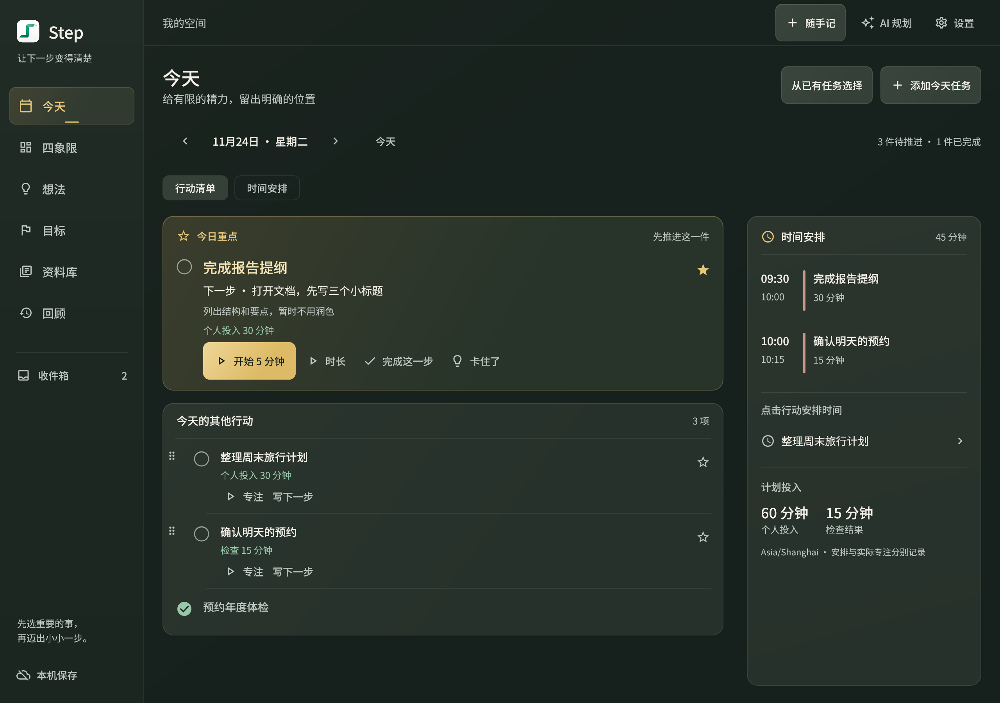

# Step Windows 使用指南

[返回首页](../README.md) · [下载与版本说明](https://github.com/Zita-Go/Pare/releases/tag/windows-v0.3.0)

先记下一件事，选定要推进的日期，再找一个能开始的小动作。无需先注册账号或配置 AI。

## 先把今天用起来

- **直接新建：**在「今天」点击「添加今天任务」，填名称、选择象限后创建，任务会同时加入今天。
- **已有任务：**点「从已有任务选择」，或在四象限的任务行点「加入今天」。
- **开始推进：**选入当天后，点星标设为重点；重点卡可以直接「开始 5 分钟」，也可以在旁边选择其他时长。
- **做完一步：**点击「完成这一步」留下记录，整个任务仍保留。任务前的圆圈用于完成整个任务。

## 日期要看哪里

「今天」和「四象限」共享同一个规划日期。四象限顶部会明确显示日期，任务行也会写出「加入今天」或对应日期；切到其他日期后创建任务，会加入当时正在查看的那一天。

点「今天」可回到当前日期。加入一天和设为重点是两个可见步骤；移出当天也会取消该日的重点与安排，任务本身继续保留。

## 安排时间

从「行动清单」切到「时间安排」。可以拖动未安排的行动进入时间轴，点击空白处或「安排时间」按钮，也可以新建或选择任务。

拖动时间块改变开始时间，拖动底边调整时长；拖向前一天或后一天可跨日移动。误操作后可撤销。

点击时间概览或时间轴里的事项，会直接打开「安排与提醒」。跨午夜的时间块会打开它原来的安排日期，避免误建另一份安排。

窄窗口默认优先展示行动清单，点「时间概览」按需展开；宽窗口在右侧保留时间概览。

## 从想法继续推进

在「想法」保留背景、发现和决定。进入「关联行动」后，点击行动标题就能打开任务；创建新行动后，也可直接打开它、写下一步。

关闭子任务会回到原想法，保留输入与页签。关联行动的完成状态和下一步可在原处查看；解除关联不会删除任务。

## 专注与等待

个人专注只记录你的投入。已有另一段专注时，需要先结束或取消，才能启动新的一段；暂停仍保留当前这段专注。

任务交给其他 AI、机器或别人时，可以记录等待，并设置回来检查的时间。多个等待可以并存，等待时长不会混入个人投入。

## 设置与同步

主窗口统一从右上角「设置」进入：

| 想调整什么 | 位置 |
| --- | --- |
| 登录、首次合并、处理同步冲突 | 账号与同步 |
| 模型服务地址、模型名、密钥 | AI 服务 |
| 规划背景与偏好 | 背景与偏好 |
| 导入、导出、恢复资料 | 本机与备份 |
| 系统通知、登录自启、退出后提醒 | Windows |
| 深浅外观、快捷键、托盘与桌面小窗 | 外观与快捷键 |

左下角的同步状态可以点击。只有最近一次同步已完成、且没有待上传或冲突时才显示「已同步」；「等待同步」与失败提示不会被当作成功。

首次登录先读取云端内容，再由你确认开启上传。中断或重开应用后，在「账号与同步」点「继续拉取云端内容」，完成后确认合并并开启同步。离线修改先保存在本机，联网后继续同步；账号失效时需要重新登录。

换设备前请先确认同步成功。计时、通知权限、快捷键、模型密钥和 AI 原始请求历史不会随任务接续或同步。更多数据边界见[数据与隐私](../README.md#数据与隐私)。

## 安装与更新

保存输入并退出旧版后运行新安装包覆盖安装，保留原资料目录。下载页同时提供 EXE、MSI、免安装 ZIP 与校验文件。

Windows 版面向 Windows 10/11 x64（Intel/AMD）。当前安装包尚无商业代码签名。退出后的提醒需要单独启用；关机、未登录或系统禁用通知时不能保证交付。

本页界面图来自 Windows 构建中的真实组件渲染，使用虚构资料，不包含系统窗口边框。
