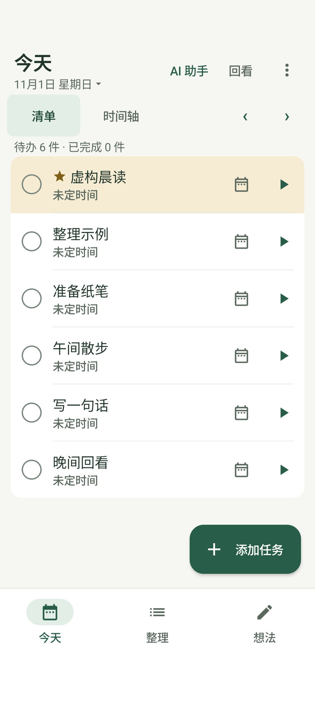
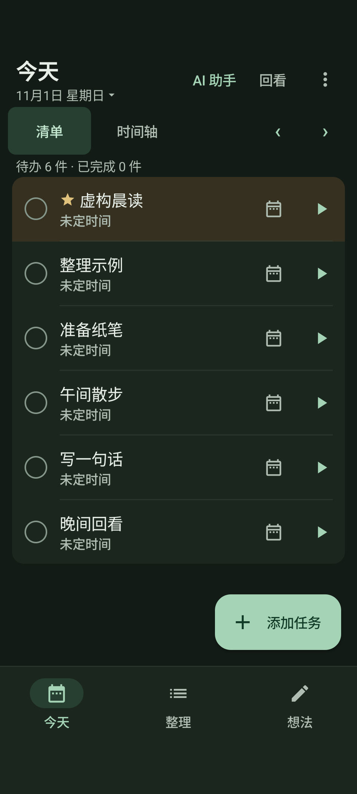
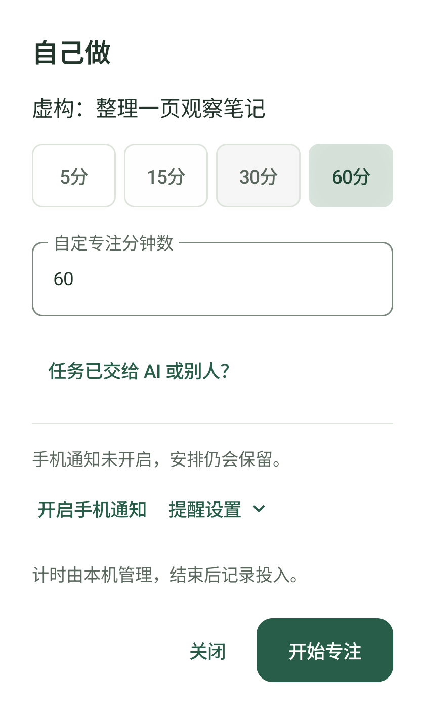
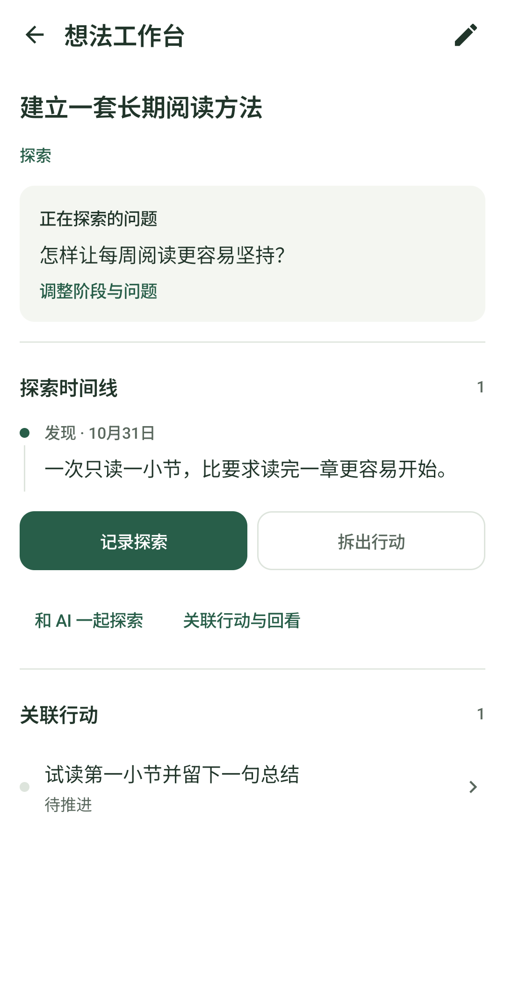
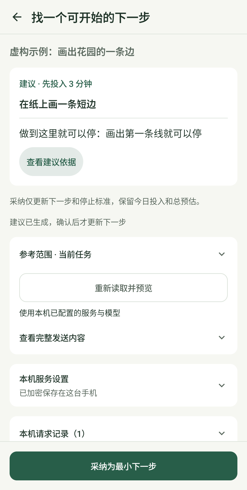

# Android 0.10.0：把整套界面统一起来

完成日期：2026-11-01。根据已确认的[跨领域设计研究](../research/2026-10-31-cross-category-ui-review.md)，本次完善现有使用流程的呈现和反馈，沿用森林绿、暖金以及Pare的想法到行动路径。

## 今天更容易看清

日期并入标题，点击日期可直接选择另一天；清单/时间轴改为较轻的绿色选中控件，前后日期仍能直接切换。时区与设备不同才在顶栏强调，日期选择器始终说明规划时区。

普通任务组成连续分组，今日重点保留星标和暖金；日历图标降低视觉重量，原有排时间、完成、开始/暂停入口仍然可见。时间文字提升到13sp，任务正文继续使用16sp，没有用缩小文字或热区换取密度。

在360×800dp、普通字号的隔离样例中，首条任务从约178.3dp开始，六件常规任务完整可见。数据包含系统安全区；大字号、异常提示或运行状态出现时不强求相同密度。

 

## 返回、保存和反馈更一致

- 管理与阅读页面使用统一顶部返回；编辑页面保留固定保存区，键盘打开时主要操作仍能找到。
- 主要和描边操作按钮统一12dp圆角，触控区域至少48dp；普通选择使用绿色，暖金主要强调今日重点。
- 目标、偏好和回顾复制成功改用短时浮层，不再把“已保存”插进正文推动布局。错误保留可见。
- 日程、元数据等编辑页只有实际修改后返回才确认丢弃；没有修改时直接返回，保存失败保留输入。
- 列表重排/完成使用Compose标准的轻量过渡；没有额外等待、强制打卡或循环装饰动画。

## 开始更直接，思考更好读

专注页先显示任务、最小下一步和5/15/30/60分钟选项，自定义时长保留。通知权限状态简短说明，未开启时有明确入口，详细系统设置按需展开。

正在推进时，主页面底部有紧凑状态入口，二级页面顶部也能查看专注状态。进入想法或AI后仍能暂停/继续，返回时保留原来页面及其草稿；不会创建第二个专注计时。

想法页按当前问题、最近三条探索记录、关联行动阅读；完整历史仍能展开，背景和长文支持选择复制，不为早期想法显示虚构进度。

AI页突出下一步、投入和停止标准，依据按需展开。所有准备采纳的变更仍可见、可选，完整发送内容、连接设置和原始历史仍然可访问；没有增加后台请求或改变授权范围。

 

## 验证与边界

- Android327项单元测试通过，Debug构建通过，Lint0错误（29条非阻断警告、1条提示）。
- 44项不同界面用例均取得通过结果。首次全套40项通过；随后纠正新容器的测试选择器，并进一步压缩重复分组标题，对相关用例分批复验。最后深浅色密度、窄工具栏及专注时长4项复验通过。
- 覆盖真实点击、日程拖动/缩放/跨日撤销、失败保存、草稿返回、窗口旋转、跨页面暂停/继续、AI假服务采纳/撤销，以及普通/大字号布局。
- 首项位置和六任务密度来自[原始布局指标](../images/android/v0.10/today-metrics.json)。截图为隔离QA包的虚构资料，保留原始像素；没有重制或借用竞品图片。
- 独立代码审查发现的日程草稿退出和窄屏日期按钮问题已修复并复核。TalkBack语音、厂商系统差异和系统减弱动态效果未做新的人工认证；动效使用框架标准机制。
- 没有更改云端协议、AI请求逻辑或真实账号数据。Mac配套版本未在本轮改版。APK为同签名的开发测试包，可覆盖安装；不等同于应用商店发布。
