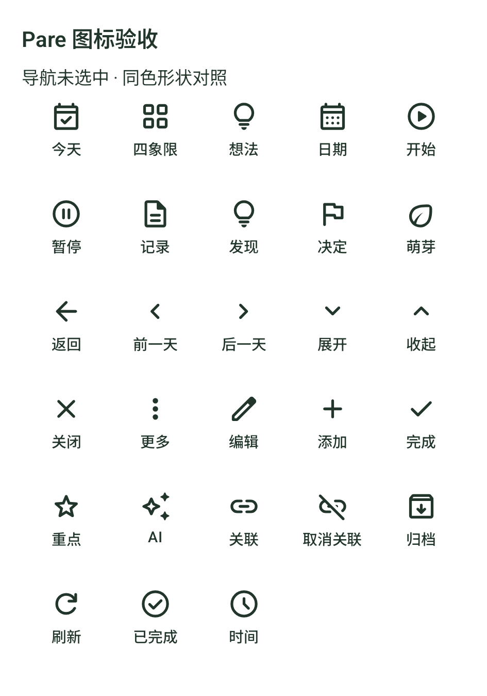
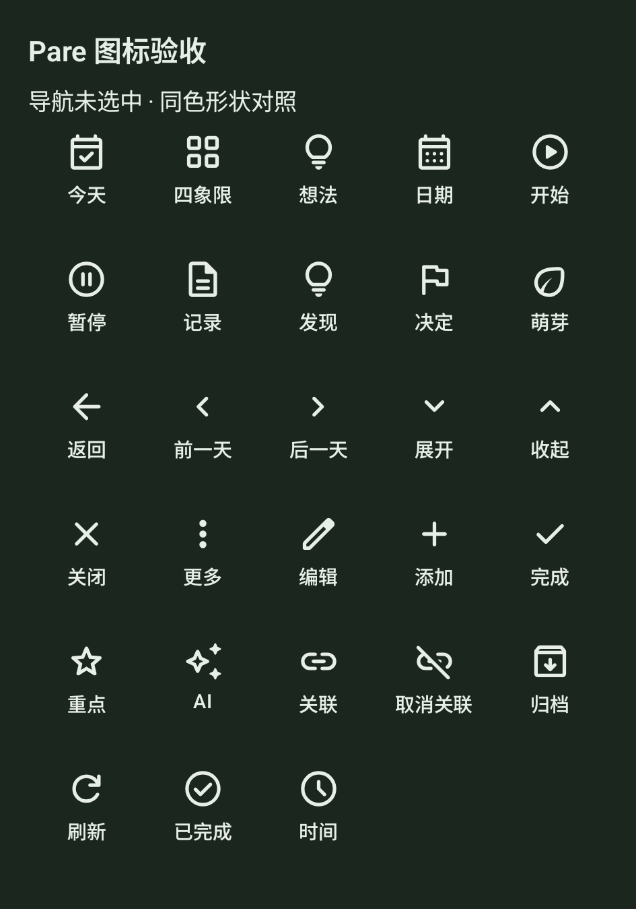
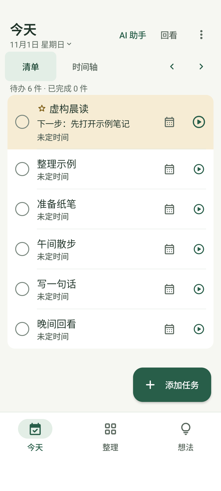
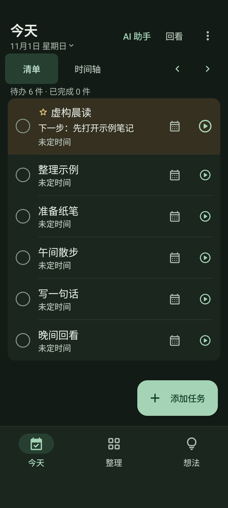
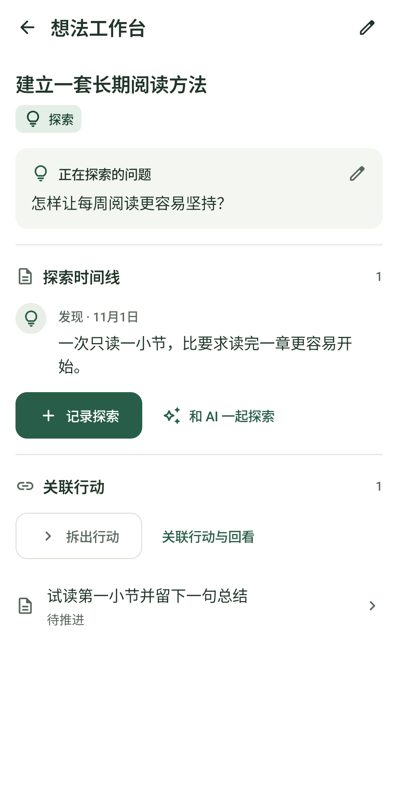
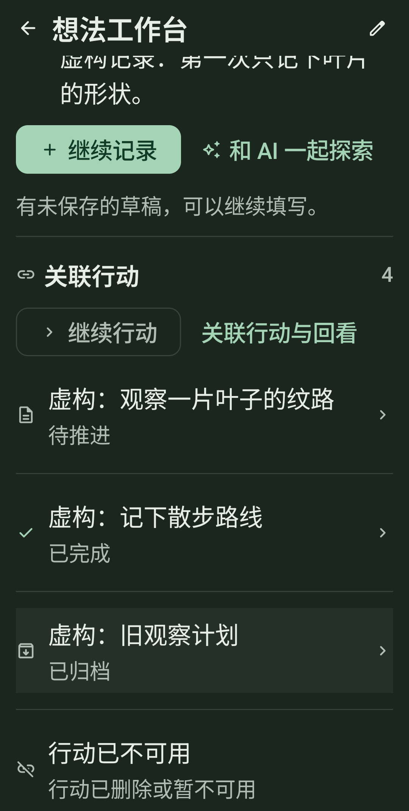
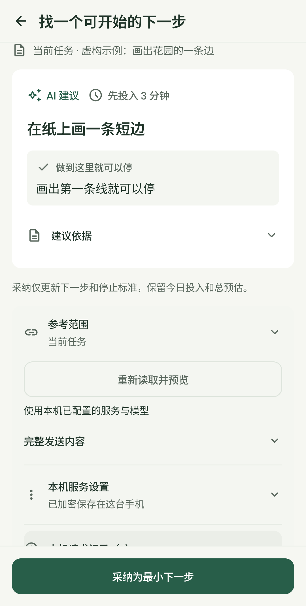
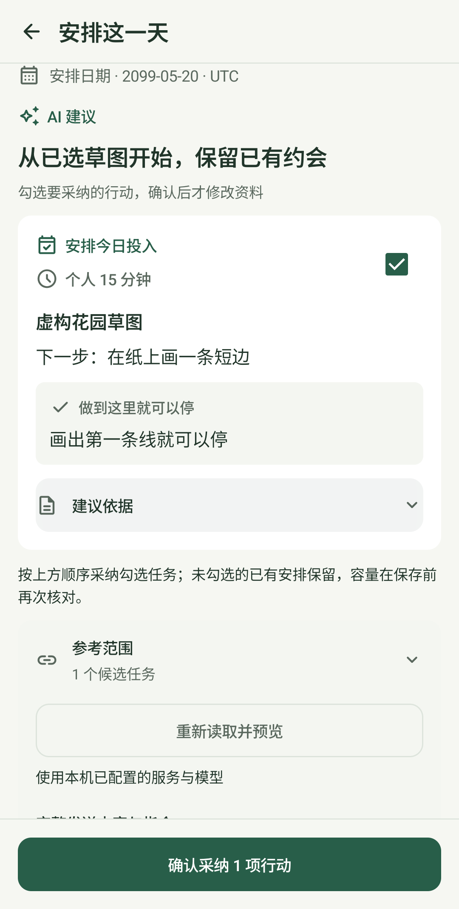

# Android 0.11.0：图标更统一，重点更清楚

更新日期：2026-11-01。开发版本号为0.11.0（versionCode13），延续森林绿、暖金和Pare的想法到行动路径。本轮完善导航、今日重点、想法工作台与AI建议的视觉细节。

## 图标表达同一种语言

「今天」「四象限」「想法」分别使用日期、四格和灯泡符号，选中时切换为同形的实心版本，文字标签始终保留。开始与暂停、前后日期、编辑、更多和展开也统一为圆润矢量图标。

图形在列表中通常为20dp、导航中为24dp，交互区域仍至少48dp。空页面仅用小符号辅助理解；普通操作保留绿色，暖金继续用于今日重点，应用启动图标不变。

本地内置30个Google Material Symbols Rounded矢量资源，不需要在线下载字体。采用固定源版本，附有完整Apache 2.0授权、修改说明和文件校验记录；详见[图标来源与许可](../../android/third_party/material-symbols/README.md)。下图是隔离测试中的实际图标展示，不是新增产品页面。

 

## 今日重点直接告诉你从哪里开始

已设为重点的任务会显示你已经填写的「下一步」；没有填写就不显示，不替你编造动作。较长内容在列表中最多展示两行，点任务仍可查看和编辑全文。普通任务保持紧凑，排时间与开始/暂停入口继续直接可用。

360×800dp、普通字号的虚构样例中，深浅色首条任务均从约154.7dp开始，六件任务完整可见。数据包含系统安全区；大字号、长文或运行提示出现时，页面允许滚动，不以缩小热区维持数量。

 

## 想法保留成长过程

想法标题旁用轻量阶段标记说明当前状态；正在探索的问题保留明确编辑入口。探索时间线用符号区分记录、发现和决定，完整历史仍可展开、选择和复制。

「记录探索」与AI探索放在探索区域，拆出行动和管理关联放在关联区域。关联行动继续明确显示待推进、完成、归档或不可用状态，不为早期想法添加虚构进度。返回后仍可继续未保存的草稿。

查看实际1.6倍字号的深色弹窗

 

## AI先呈现可采取的动作

建议区突出下一步、投入时间和停止标准，依据按需展开。页面用简短标签说明本次审阅的任务、主题或日期与时区，生成建议和采纳后仍能辨认对象。多项规划保留每项准备写入的内容与勾选框。

参考范围、连接设置和本机请求记录收进较轻的辅助区域，完整发送内容和原始回复仍能查看。打开这些区域不会发送请求，也不会改变勾选结果。预览、主动生成、审阅采纳和条件撤销流程不变，密钥与原始历史继续仅在本机加密保存。

 

## 验证与边界

- 327项单元测试通过，最终Debug构建成功；Lint为0错误、29条非阻断警告及1条提示。
- 47条不同界面用例均有通过记录：首次全套44条通过；修正文字布局判断、合并语义下的标签定位和日期选择器的歧义后，9条相关用例复验通过。最后的AI对象标签调整另经两个AI测试类、共3条用例复验。上述是合并覆盖结果，不是最后一次全套47条的单次运行结果。
- 覆盖导航实际点击与选中图形、48dp热区、深浅色密度、实际1.6倍字号想法弹窗、草稿和完整历史、关联行动状态，以及AI假服务的选择、上下文、采纳、撤销和原始记录。既有日程手势、日期切换及专注流程也在本轮全套中运行。
- [布局指标](../images/android/v0.11/today-metrics.json)和截图来自独立的`com.pare.app.qa`与虚构资料。图片保留原始像素，没有放大重绘，没有真实任务、账号、密钥或真实AI历史。
- 独立代码审查未发现阻断项。图标来源、选中变体、方向镜像和随包授权文件已核对。
- 本轮没有请求真实模型、重新认证实体手机/TalkBack/厂商后台限制，也没有改变Mac、云端或同步协议。产物是本地开发Debug包，尚未作为新版本公开发布。
- 安装包已通过签名校验，并覆盖安装到现有可见模拟器，保留原应用资料；已核对安装版本0.11.0（13）及前台启动状态。
