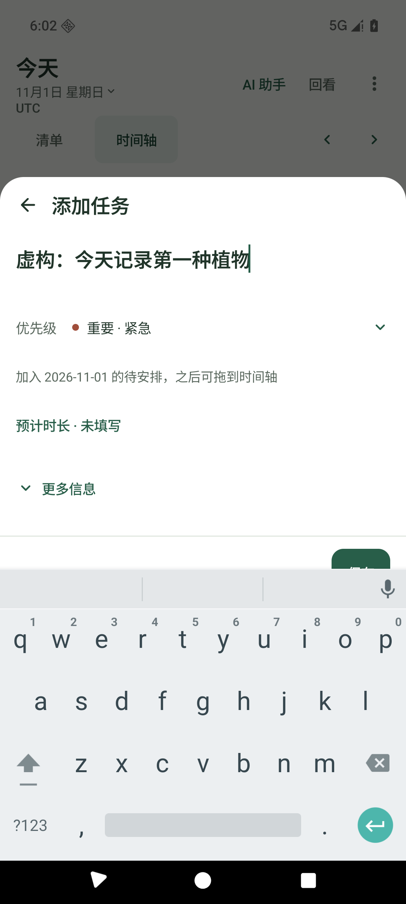
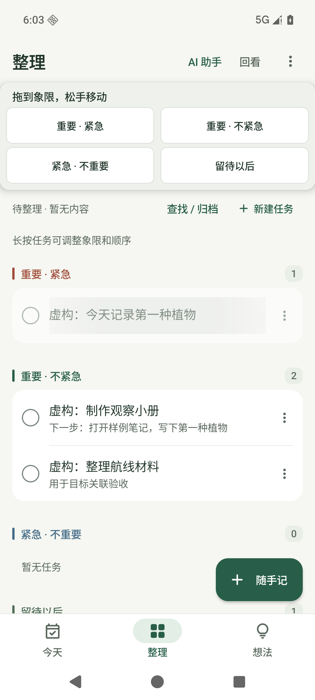
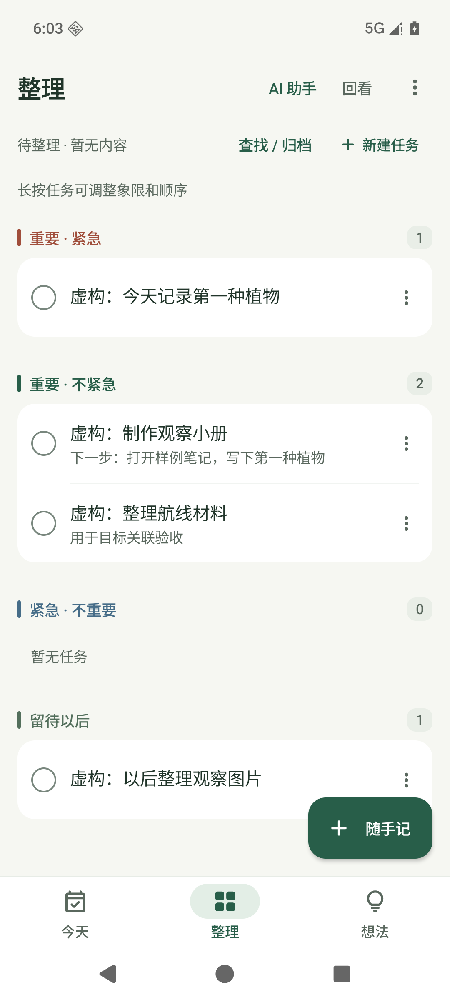

# Android 0.12.0：直接选优先级，长按整理任务

更新日期：2026-11-01。本地开发版，versionCode 14。

## 新建时就能看到优先级

今天的「添加任务」和整理页的「新建任务」都在任务标题下直接显示优先级，点一下即可选择四象限，不必展开「更多信息」。已有任务详情也使用相同位置。备注、下一步和预计时长继续保留，保存失败或返回时仍能保留草稿。

## 整理页支持拖动

长按任务，出现四象限目标栏：

- 拖到目标象限再松手，改变任务优先级；空象限也可以接收。
- 拖到同象限另一条任务的上半部或下半部，调整先后顺序；插入线表示落点。
- 靠近列表上下边缘可自动滚动；源任务滚出屏幕后仍可继续拖动。
- 移动过程中只预览，松手才保存。取消、拖到区域外、长按后原地松手，都不会保存或误打开任务。

目标栏仅在拖动时出现，单独占位，不遮住第一条任务。也可直接打开任务详情修改优先级，任务提供辅助功能的「移至…」动作。待整理的随手记仍通过原有「整理」入口归类，本次拖动针对已经创建的任务。

象限调整沿用内容同步；象限内手动顺序使用独立字段，不影响今日计划或时间轴的顺序。目前该手动顺序在Android显示，Mac仍按原有方式排列任务。拖动结束时重新检查任务状态、同步冲突和位置变化，拒绝覆盖过期内容。

## 底部导航更紧凑

普通字号的导航内容从80dp缩为约64dp（加分隔线），仍保留图标和文字、至少48dp触控区域。大字号自然增高，系统手势/按键安全区单独保留，避免把按钮挤到系统返回键旁。

## 验收范围

- 339项单元测试通过；Debug构建成功；Lint 0错误、29项非阻断警告、1项提示。
- 22条不同相关界面用例取得通过结果。首批21条中19条通过，随后修复导航高度及静止长按误触问题，6条导航/拖动用例复验通过；再通过1条完整主界面集成用例。这不是本轮全部UI测试的一次性运行。
- 真实Dialog验证键盘打开时优先级可见，以及1.6倍字号下选择、保存与草稿行为。真实手势验证取消、空象限、重复移动、前后排序、失败不发布新状态和边缘滚动。
- 完整流程从两个入口创建任务，检查实际QA数据库、今日计划边界，再拖到另一象限；Activity重建后保留结果。截图是1080像素宽的原生截图，只有虚构资料。
- 多代理分别实现优先级、导航和数据动作，并进行独立交互复核。没有重新验证实体手机、TalkBack语音、真实账号云端同步或真实模型服务。

安装包已通过签名校验，覆盖安装到本机可见安卓模拟器，已核对版本0.12.0（14），原有资料保留。
