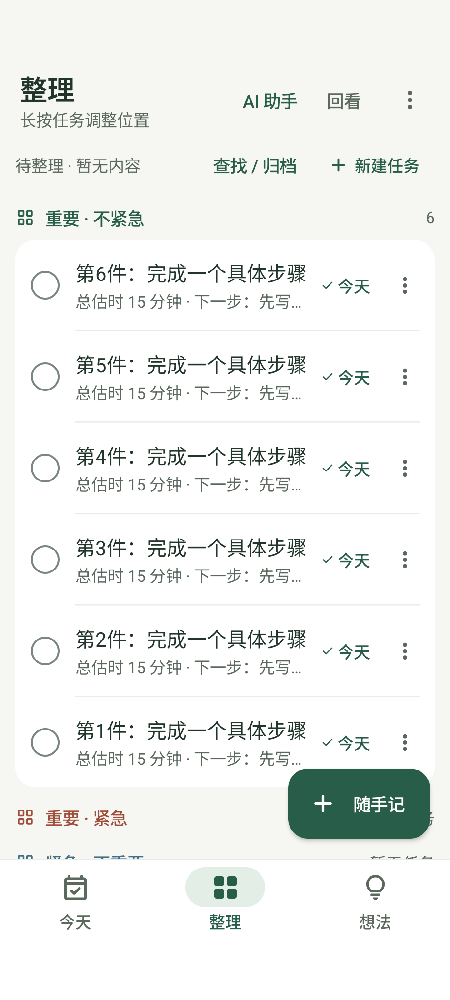
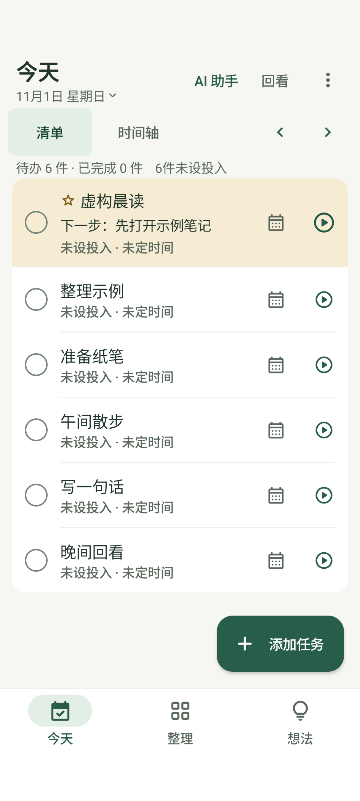
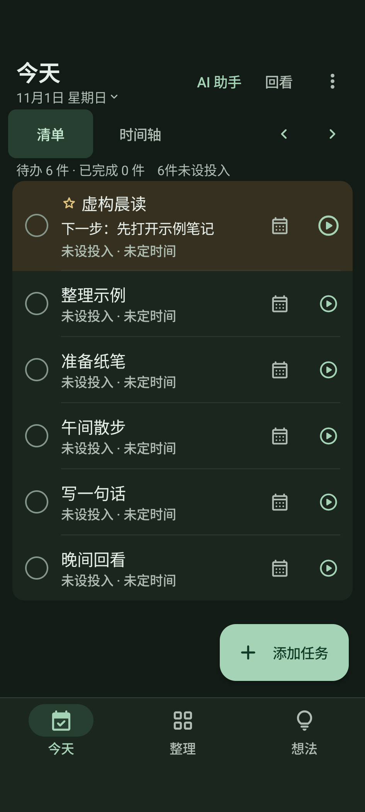
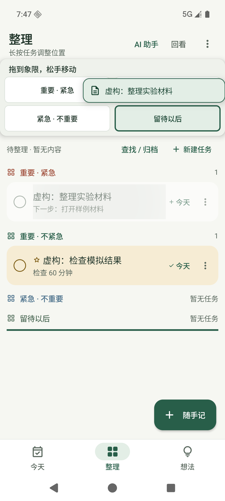

# Android 0.13.0：选出今天，从桌面开始一小步

更新日期：2026-11-01。本地开发版，versionCode 15；Android 8.0 及以上。

这一版把「四象限取舍 → 选出今天 → 最小下一步 → 开始推进」接得更顺，并加入可放在手机桌面的今日组件。

## 从整理直接选到今天

整理页每件未完成任务旁都有「＋ 今天」。点一下即可加入当前规划时区的今天；保存后变为「✓ 今天」，再次点击会打开今天，方便确认安排。选择只改变当天任务列表，原有时间块、投入和提醒继续保留，不会自动安排时间或启动专注。

今天还没有任务时，可点「从四象限选一件」，按象限挑选已有任务。已选、已完成、已归档或有冲突的任务不会重复出现在可选列表中；查看其他日期时，选择会加入正在查看的那一天。

整理页优先显示有任务的象限，空象限集中在后面并缩小留白；四象限及空象限的拖动落点都保留。

## 今日投入与日历时长分开

今日任务显示这一日已经保存的「个人投入」或「检查」分钟数，未设置时显示「未设投入」。汇总分别统计个人投入、检查时间和未设置的任务数。时间块长度、整件任务的预计时长，以及等待 AI 或他人结果的时间，含义各不相同。

今日重点与已经保存的最小下一步继续保留。清单和时间轴使用相同的日期与日程来源，包括旧版跨日安排、跨午夜时间块；完成项仍可展开回看。

  
  

## 打开任务，先看到怎么开始

已有任务详情先显示标题、优先级和「最小下一步」，接着是「开始专注／查看进度」与「拆小一点」。AI、提醒、安排时间、截止日期等继续放在「AI、提醒与其他操作」中；备注和预计时长可从「更多信息」展开。

点击「开始专注」会打开时长选择，保留 5、15、30、60 分钟及自定义输入，确认后才开始。有未保存修改时先保存，失败会保留草稿；打开详情或保存下一步本身不会计时。「拆小一点」继续提供只保存，以及明确选择保存后开始五分钟的操作。

## 拖动看得见，也能撤销

长按整理页任务时，带任务名称的预览跟随手指，四象限落区和行间插入线指示位置。松手才保存；取消拖动不修改内容。

成功移动后会短暂显示「撤销」。如果任务位置仍是本次移动的结果，可恢复移动前的象限和顺序；若位置或相关状态已再次改变，会说明原因，不覆盖后续调整。任务备注和历史不随撤销回退。

## 把今日与专注放到手机桌面

在 Pare 右上角打开「更多 → 添加桌面小组件」，再按桌面启动器的提示确认添加。也可以长按手机桌面，在「小组件」中找到「Pare · 今日与专注」。部分启动器不支持应用内添加，此时使用桌面的小组件列表。

组件显示当天重点或首个已选行动、保存的最小下一步，以及本机专注状态。组件与今日清单使用同一套日期和可见任务判断；没有行动、设备尚未解锁或读取失败时，会明确提示。

- **快速收集：** 打开 Pare 的随手记；已有未保存草稿时，先让你选择继续原草稿。
- **开始专注：** 打开 Pare 的时长选择，确认后才开始；已有本机运行和其他设备状态的检查继续生效。
- **暂停／继续专注：** 打开 Pare 后操作对应的本机专注；点击时会核对任务和该段运行身份。若桌面显示已经过时，则打开控制页，不操作后来新建的另一段专注。
- **查看专注：** 到点、待保存或状态需要检查时，打开对应记录处理。

  
  

组件展示本机任务内容，仅供手机主屏幕使用。内容与运行状态变更会触发刷新，并安排日期切换和专注到点刷新；系统省电限制可能延迟后台更新，因此标题注明日期。组件刷新只读取本机资料，不请求账号凭据、云端内容或模型服务。

## 验收范围与边界

- 使用独立 `com.pare.app.qa` 安装与虚构资料测试，截图不包含真实任务、账号或模型历史。369 项单元测试、Debug 构建与 Lint 检查通过；73 条不同设备用例均取得通过结果，来自首次全套与修正后的定向复验；不是最后一次全套单次运行。Lint 为 0 错误、43 条非阻断警告、1 条提示。
- 组件原生 RemoteViews 明暗主题、大字体渲染，以及真实主界面收集、选择时长、暂停／继续和陈旧点击保护用例已在定向复验中通过。今日选择器和密度用例也已复验通过；这些结果属于首次全套运行与修正后分批复验的合并覆盖。
- 模拟器上已使用真实 AlarmManager 安排 5 秒后的提醒并观察到通知；通知的私密元数据和点击打开任务已验证。此次没有观察熄屏或锁屏状态，不能据此认定锁屏送达通过。
- 已完成真实两阶段强停恢复：保存虚构任务、投入、提醒、离线队列和专注记录后，确认前台 QA 进程退出；新进程恢复同一记录，结束与重复核对后只有一条历史。实体手机验收按用户选择暂缓；普通系统回收、真实设备重启、厂商省电策略和长期后台运行没有新增结论。
- 本轮没有真实账号云端同步或真实模型服务验收，也没有修改 Mac 代码。AI 原始请求展示、模型配置与授权范围沿用现有行为；各设备仍管理自己的计时，桌面组件不能控制另一台设备。

本页描述开发验收产物，尚未发布新的公开下载版本。

[逐项验收记录](../testing/android-013-reliability.md)与[机器可读结果](../testing/android-013-evidence.json)记录了覆盖边界。开发 APK 已通过签名检查并覆盖安装到模拟器，版本0.13.0（15），原资料保留。
