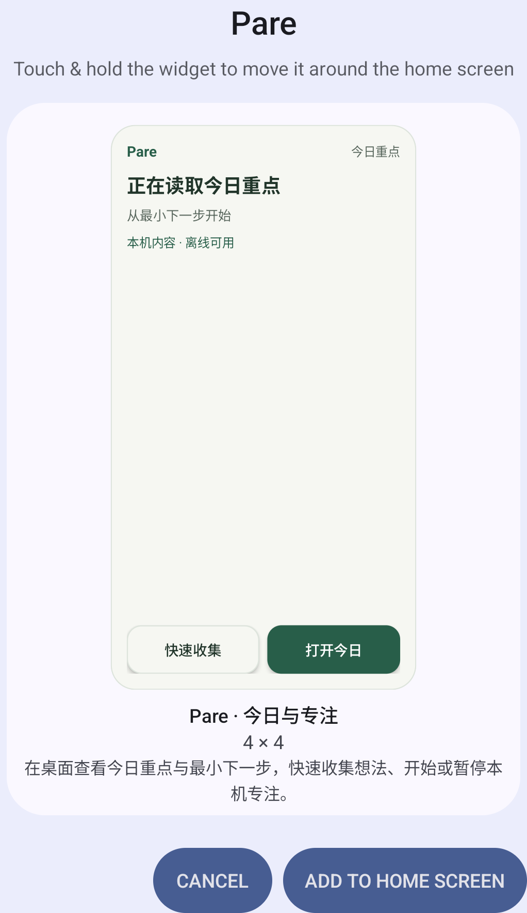

# Android 0.13.1：让桌面组件添加结果更明确

日期：2026-11-01；开发版本0.13.1（16）。

「更多 → 添加桌面小组件」会请求系统桌面确认。Pare现在明确区分请求已发出、尚未检测到新增组件、不支持、失败和已确认添加；只有本应用新增绑定组件ID才显示成功，已有组件不算本次添加。也可按页面说明长按桌面，通过系统的小组件列表添加。

从系统窗口取消后，Pare显示尚未检测到新增组件。页面重建不会自动再请求；请求阶段与原组件ID基线通过SavedStateHandle保存。系统调用或查询失败有明确反馈，不会直接崩溃或误报成功。

截图来自隔离QA包的实际默认桌面确认窗口。测试点击了Pare菜单入口，确认窗口属于系统解析得到的默认HOME包，并包含Pare与可点击添加控件；随后取消，验证组件绑定ID未增加、未确认提示可见、重建后不重复弹窗。测试没有确认添加，不将弹窗出现称作已经放到桌面。

## 当前专注通知范围

当前仍只有专注到点提醒，需允许系统通知。专注进行中尚无常驻倒计时卡片，也不能从通知栏暂停或继续；App与桌面组件中的专注操作保持原有范围。

## 验证

- 373项单元测试通过，Debug构建与签名检查通过，Lint 0错误、43条非阻断警告、1条提示。
- 新增真实桌面确认、取消、界面重建流程通过。当前默认桌面支持pin，因此“不支持桌面”的设备分支按条件跳过；不将跳过视为通过。支持返回值、取消/旧绑定不误报成功、异常与保存状态恢复由单元测试覆盖。
- 原组件的3条收集/时长确认/暂停继续及陈旧请求流程在本次改动的前段回归中通过；本补丁未重跑全部设备用例。
- 首次测试误将包可见性受限的系统FallbackHome当默认桌面，现仅QA构建声明HOME查询；随后修正Compose测试时钟同步，实际菜单关闭及请求执行后才观察原生窗口。生产构建没有新增查询权限。
- 实体手机与其他桌面启动器未在本轮测试。截图仅含虚构QA资料，API密钥与本机配置没有进入仓库。
