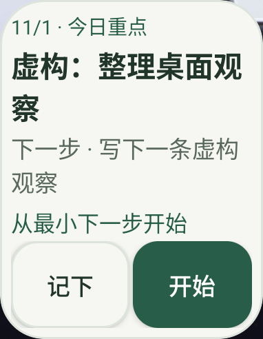

# Android 0.13.2：默认2×2的桌面组件

日期：2026-11-01。开发版0.13.2（17）。新添加的小组件请求占桌面两列、两行，旧系统使用110dp最小尺寸兼容；不同桌面的格距不同，2×2并不表示物理正方形。[Android尺寸规则](https://developer.android.com/develop/ui/views/appwidgets/layouts)。

## 更小，但操作仍清楚

紧凑卡片保留任务、最小下一步和两个快捷操作，按钮用「记下、开始、暂停、继续、查看」等短标签，并保留完整无障碍说明及48dp点击区域。特别小的画布配合大字号时，隐藏次要文字，完整内容可点击查看；拉大组件后恢复更多信息。

有本机专注时，标题、下一步和控制按钮统一指向该任务，避免显示今日重点A却暂停任务B。点击任务内容打开对应推进页，不直接开始或暂停。已有运行身份检查与确认时长流程保持。

## 实际放上桌面核对

本轮在隔离QA包实际点击系统Add按钮，新增一个组件，并等到真实任务内容出现；不再只以预览里的「2×2」为依据。当前模拟器的默认桌面网格偏高：公开DeviceProfile报告单格207×375px，实测组件宿主382×718px，与两格扣除Launcher3的6dp内边距相符。框架默认padding是另一个值，测量记录分别保存。[Launcher3尺寸计算](https://android.googlesource.com/platform/packages/apps/Launcher3/+/master/src/com/android/launcher3/widget/util/WidgetSizes.java)。

因此这台桌面的2×2槽位仍是长方形。高窄槽位使用按内容高度收紧的卡片，减少内部空白；卡片之外的透明余量仍属于该组件的2×2占位，不能另放图标。没有修改用户桌面网格设置。

[实际宿主、卡片、按钮尺寸与网格对照](../images/android/v0.13.2/placement.json)。截图仅含虚构QA资料；Android无障碍树未直接暴露跨度，结论结合目标占格、宿主尺寸与公开网格诊断，不把缺失字段伪装成读到的值。

已有桌面组件可能保持原尺寸：升级后可长按缩小，或移除旧组件后重新添加。支持应用内添加的桌面可从「更多 → 添加桌面小组件」进入。

## 验证范围

- 373项单元测试通过；Debug构建和签名检查通过；Lint零错误（非阻断警告见构建报告）。
- 实际原生布局覆盖11组尺寸、普通/1.3/1.6字号和明暗主题，共66种组合，检查可见文字边界、两个按钮48dp宽高及互不重叠。
- 6条不同相关设备用例分批通过：原生渲染、真实放置、添加确认/取消/恢复，以及原有3条组件收集与专注操作。当前桌面支持添加，不支持桌面的条件分支跳过，未将其算作通过。
- 最后两条真实放置和渲染用例复验通过。正式应用资料保留，临时QA组件随测试包卸载清理。
- 真机及其他厂商桌面未实测；本次不增加通知栏常驻专注卡片，也不改变AI、账号与同步范围。

开发安装包已通过签名检查并覆盖安装到现有模拟器，版本0.13.2（17），正式应用资料保留。
