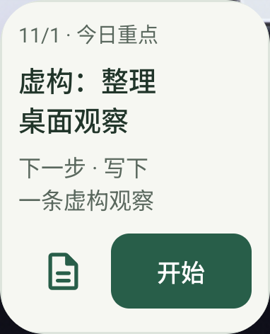
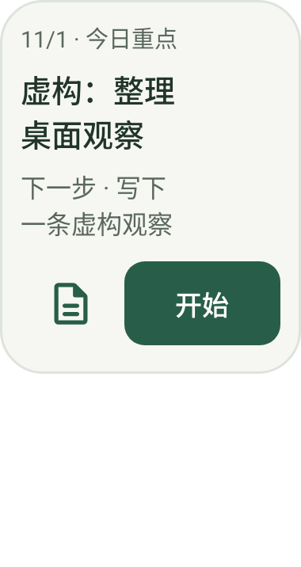
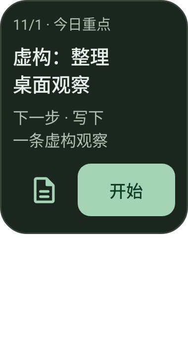

# Android 0.13.3：桌面卡片视觉精修

更新日期：2026-11-01；开发版0.13.3（18）。沿用2×2占格与浅底深绿配色，按实际桌面上的145×273dp宿主尺寸改善排版。

- 标题改为较轻的中等字重，采用均衡断行；示例中的「察」不再孤立落到下一行。日期状态更轻，标题和下一步的边距统一。
- 日常页面去掉「从最小下一步开始」等重复提示；读取失败、状态需检查、到点和待保存等重要提示继续显示。
- 左下角的笔记图标是随手记入口。右侧绿色按钮突出开始、暂停或继续；绘制区域更轻，实际点击区域仍至少48×48dp。
- 外框圆角与主按钮比例收紧，去掉按钮默认浮起阴影。正常任务、实际下一步及操作目标仍来自同一条本机记录。

点击笔记图标打开随手记；开始仍进入时长选择并等待确认，暂停/继续仍校验运行身份。高窄桌面中的透明余量属于2×2宿主占位，没有把它变成可放其他图标的空间。

## 已有组件升级

新版使用独立的布局资源ID，避免桌面把旧按钮结构直接套上新数据；保留旧资源以维持原ID。实测原生AppWidgetHostView能把旧按钮视图重建为新图标控件。升级后打开一次Pare可触发刷新，不需要清空任务数据。

## 验证范围

- 374项单元测试通过；Debug构建、签名检查通过；Lint 0错误（100条非阻断警告和1条提示，包括保留的迁移资源与现有文字资源检查）。
- 本次相关设备测试9条通过；当前桌面支持添加，因此不支持桌面的条件分支1条跳过，未将跳过算作通过。未重新运行全部应用设备用例。
- 包含66组尺寸/字号/明暗组合、真实145×273dp的6组标题断行检查、重要提示、原生宿主旧布局升级、实际桌面放置，以及现有组件操作和添加确认流程。
- 独立视觉复核对比旧截图，确认标题与下一步断行、主次操作及留白有明显改善。截图是虚构QA资料；仍未在实体手机或其他厂商桌面验收。

