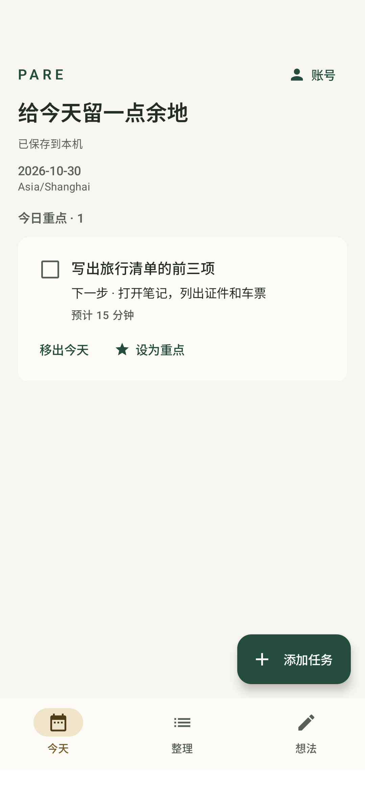

# Android 0.2.0 开发预览

本轮优化自动同步和手机常用操作。Android 8.0+，开发签名，尚未正式上架。

## 使用起来有什么变化

- 今天可以直接添加任务并加入计划，任务详情能设置下一步与预估分钟数。
- 今天、整理、想法采用统一的浅色/深色主题、图标和触摸区域；已完成任务可折叠，想法阶段显示中文。
- 保存失败保留草稿，旋转屏幕也不会丢失正在编辑的内容。另一端在此期间修改或删除记录时，手机不会静默覆盖；可比较最新内容后决定。
- 同步状态为主，立即重试、暂停、退出收进详情。常规同步不会让任务列表上下跳动。

## 自动同步

首次登录并确认开启后，修改保存、回到前台、网络恢复会触发同步；停留前台时每15秒检查。后台使用 WorkManager 的联网约束任务和定期检查，失败自动退避重试。

后台周期的最小请求间隔为15分钟，实际时刻由 Android 安排，可能因休眠或省电而延后；这不是锁屏秒级同步承诺。[Android 官方说明](https://developer.android.com/reference/kotlin/androidx/work/PeriodicWorkRequest)

暂停或退出后停止后续自动请求，待上传内容保留。已经发出的网络请求可能已在云端提交，恢复时沿用同一操作标识核对回执，避免重复创建。

## 安装与验收

安装 `Pare-Android-0.2.0-debug.apk` 可覆盖0.1.0测试版，保留应用数据；不要卸载或清除存储来升级。两端继续使用同一个Pare同步账号。

69项单元测试、2项模拟器界面流程测试通过；构建成功，lint 0错误、13项非阻断建议。正式UI测试使用独立QA包和虚构数据，覆盖新增、编辑、草稿恢复、跨端更新保护、完成、重开、想法、大字体与错误反馈。

截图来自模拟器实际Compose界面，原始分辨率1080×2400。更多截图见[整理](../images/android/organize.png)、[想法](../images/android/ideas.png)和[大字体错误反馈](../images/android/editor-large-font.png)。

真机省电/后台行为仍待验收；移动端AI、提醒与专注计时不在本轮交付中。没有修改Mac正式安装或云端认证配置。
