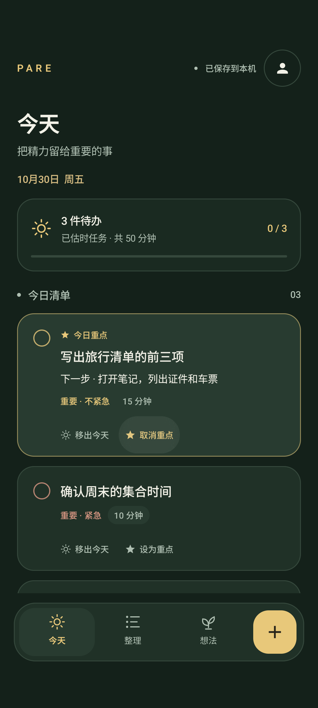
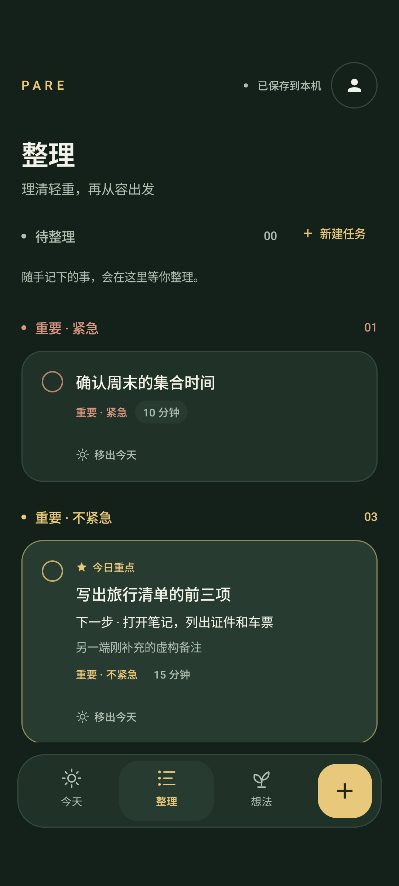
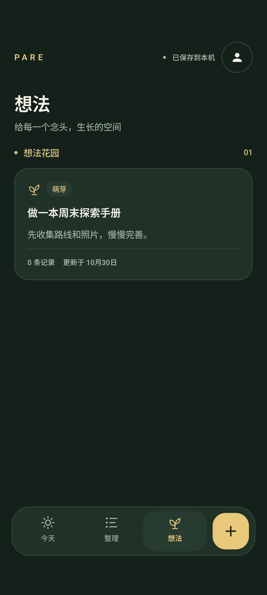
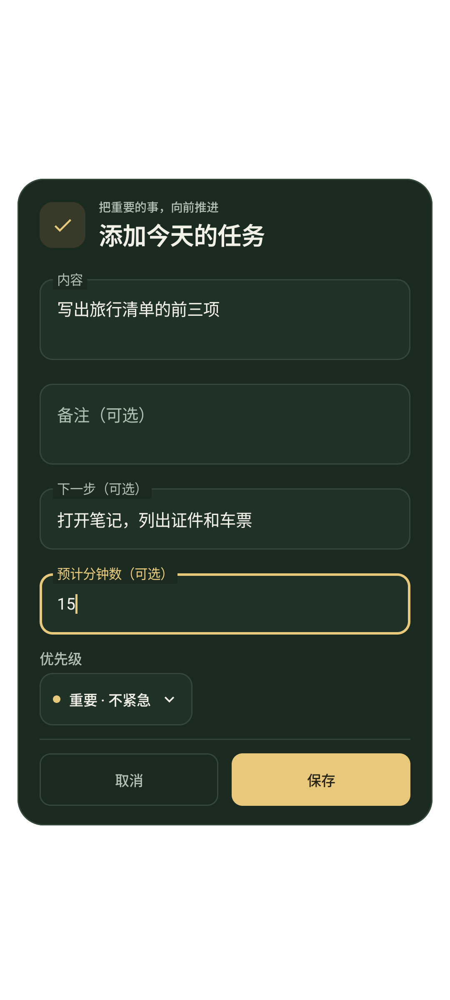
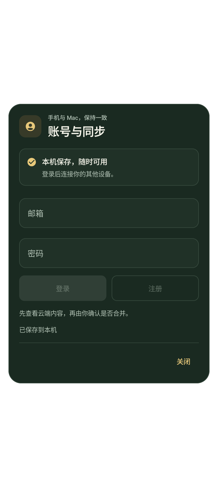

# Android 0.3.0 视觉重设计

这一版重点重做手机界面，默认采用深绿暖金配色，保留0.2的自动同步、草稿恢复和跨端编辑保护。

## 页面变化

- **今天**：简短页面标题、中文日期、真实计划概览和完成进度。今日重点单独用金色强调，任务信息与次要操作分层。
- **整理**：按象限色彩组织任务，压缩空分组和重复说明，让更多内容进入首屏。
- **想法**：萌芽图标、阶段标签、更新日期与记录数量，呈现尚在完善中的想法。
- **底部导航**：今天、整理、想法和添加入口收在同一个导航条内，不再用大悬浮按钮遮挡列表。
- **编辑与账号**：统一圆角、字号、输入框和按钮；保存/取消及错误反馈保持可见，1.6倍字体仍可滚动操作。

## 实际界面

以下截图由隔离模拟器的 Compose 界面测试生成，原始分辨率1080×2400。全部使用虚构数据，没有使用生成图片代替真实界面。

| 今天 | 整理 | 想法 |
| --- | --- | --- |
|  |  |  |

| 任务编辑 | 账号与同步 |
| --- | --- |
|  |  |

## 安装与验收

`Pare-Android-0.3.0-debug.apk` 可覆盖安装0.1/0.2测试版，保留已有应用数据。仍为开发签名测试包，尚未正式上架。

74项单元测试、2项模拟器界面流程测试通过，lint 0错误、13项非阻断建议。测试覆盖新增/编辑、旋转后草稿恢复、另一端更新保护、任务完成、想法、账号页面、布局稳定性和大字体错误提示。

这一版没有改变同步协议或上传范围，也没有修改Mac应用和云端配置。移动端AI、提醒、专注计时及各厂商真机省电行为仍在后续范围。
