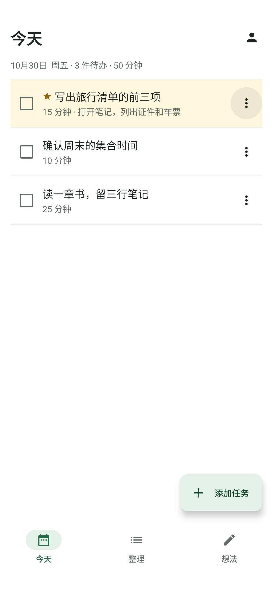
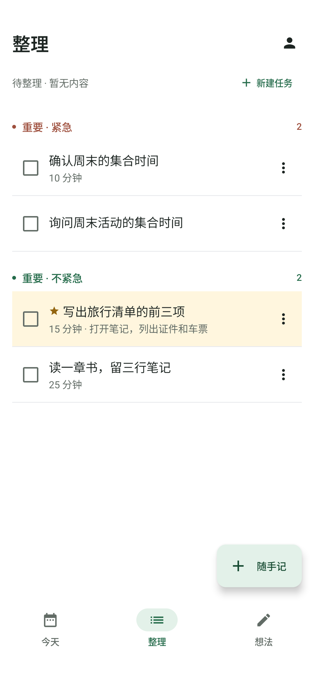
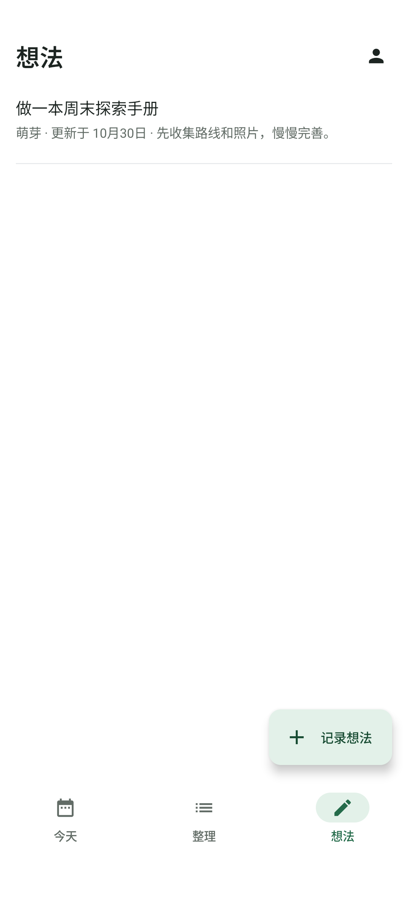
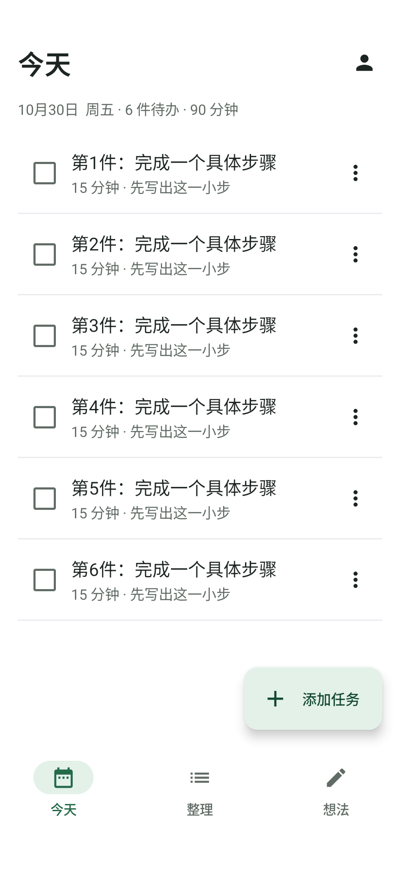
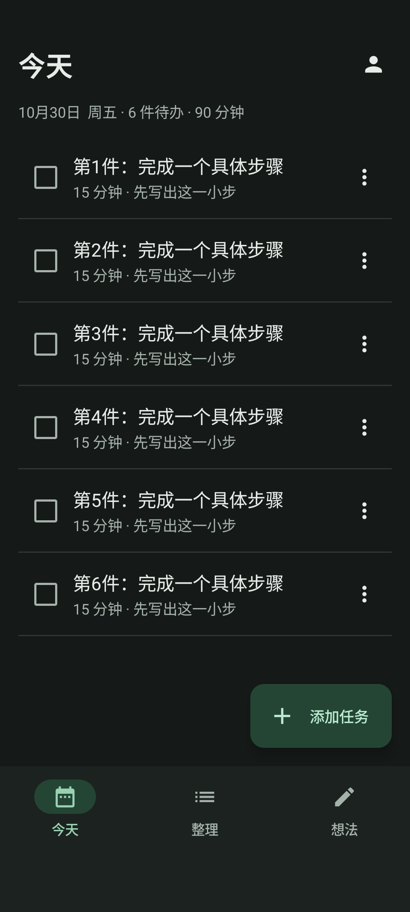

# Android 0.4.0：为行动而设计的列表与录入流程

本轮研究了Things、Todoist、TickTick的官方界面/交互资料及Android可访问性规范，重新定义页面结构。借鉴范围是成熟基础体验；Pare仍以想法孵化、四象限取舍、今日重点和最小下一步为核心。见[产品原则](../product-principles.md)和[完整设计依据与规格](../superpowers/specs/2026-10-30-android-product-design.md)。

## 已落实的决定

| 部分 | 决定 | 原因 |
|---|---|---|
| 顶部 | 56dp顶栏，24sp标题，日期/简报一行 | 首屏尽早展示任务 |
| 普通任务 | 72dp基准行、1dp分隔，16sp标题/13sp摘要 | 扫描清楚，长标题与大字体自然增高 |
| 操作 | 48dp点击区域；完成、详情、更多菜单分开 | 既紧凑又容易点中 |
| 新建/详情 | 新建自动聚焦标题、可选信息展开；已有任务完整详情 | 快速接住想法，不要求先填表 |
| 整理 | 明确选择四象限，可选加入今天，原子转换 | 分类承担Pare的取舍逻辑 |
| 色彩 | 中性明暗主题跟随系统；绿色用于主动作，金色标记今日重点 | 让颜色有明确含义 |
| 导航 | 3个页面目的地；添加动作单独显示创建对象 | 不把导航和操作混在一起 |

在360×800dp、标准字体的固定测试视口中，第一条任务起点实测约119dp，6条任务全部可见；每行含分隔线约73dp。[原始测量](../images/android/v0.4/layout-metrics.json)。0.3此前示例图的首项约405dp，主要空间被页头、宣言和统计卡占用。

## 实际截图

| 今天 | 整理 | 想法 |
|---|---|---|
|  |  |  |

| 六任务明亮主题 | 六任务深色主题 |
|---|---|
|  |  |

这些是隔离QA应用的实际渲染，使用虚构数据。对话框截图仅包含该窗口的内容；没有用生成图片代替应用界面。

## 验收与安装

- 79项单元测试、3项模拟器界面流程测试通过，lint 0错误、13项非阻断建议。
- 验证自动聚焦、标题直接保存、可选信息展开/草稿恢复、跨端编辑保护、显式分类、完成与持久化、大字体和明暗主题。
- 保留自动同步与既有数据协议，没有修改Mac安装、云端配置或真实任务。
- `Pare-Android-0.4.0-debug.apk` 可覆盖旧测试包，保留已保存的数据。仍是开发签名版本，未正式上架。

后续优先贯通Pare自己的想法探索/行动关联、个人与并行推进、卡点/提醒及有上下文的AI。它们在安卓端尚未完整接入，不能把这次界面重构当作全部功能完成。
