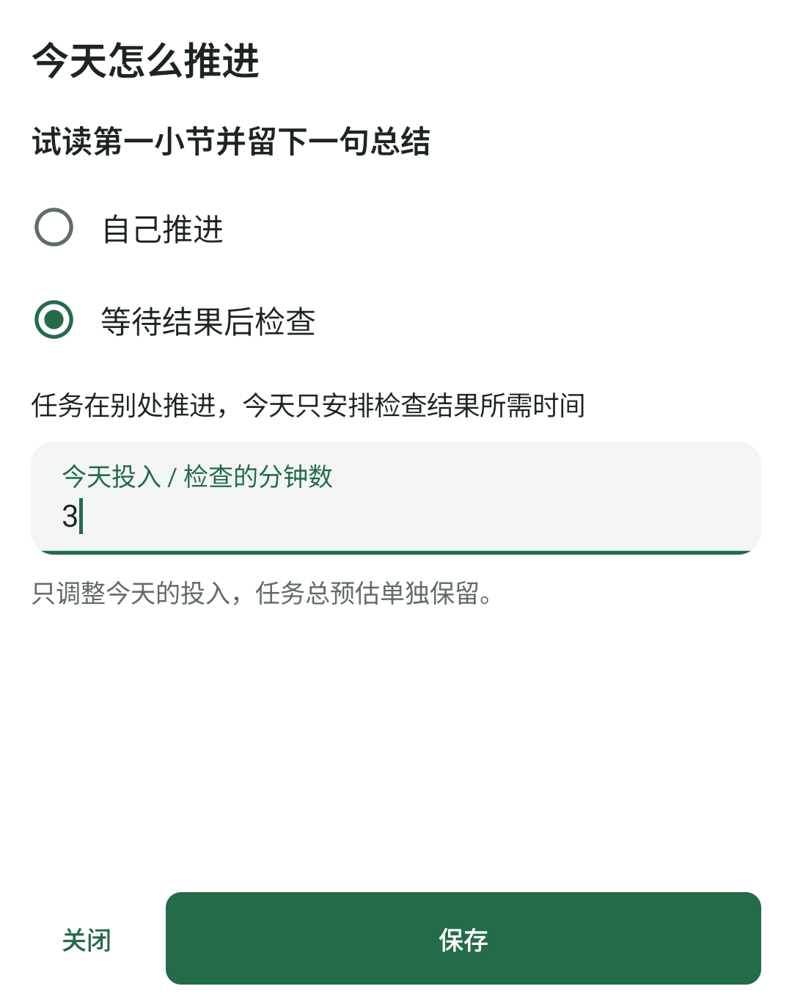

# Android 0.5.0：让想法逐步长成行动

这次围绕 Pare 自己的核心路径完善安卓端：**把想法留下来，逐步探索，拆出具体行动，再决定今天推进多少。** 沿用 0.4 的清楚列表与明暗主题，让特色体现在真正能走通的流程中。

## 现在可以怎样使用

### 1. 给长期想法一个工作台

在「想法」页点开一个想法，可以设置阶段与正在探索的问题，追加记录、发现或决定。准备行动时点「拆出行动」，填写具体任务、下一步、完成标准和象限，也可以直接加入今天。

新任务与原想法保持关联；行动完成后，背景和探索记录仍在。已归档的想法可以回看，恢复后再继续积累。记录与关联行动较多时分批展开，不把整个历史一次堆在屏幕上。

### 2. 把今天的投入安排清楚

在任务的更多菜单中选择「今天怎么推进」，可以安排自己投入的时间，也可以安排等待外部 AI、机器或其他人推进后，检查结果所需的时间。

首页分别汇总个人投入、检查时间和尚未安排的任务。任务总估时单独保留，例如总共需要 2 小时的任务，今天可以只安排 10 分钟。已有今天的日历时间块会明确提示时长调整，未来日期的时间块不会跟着改变。

### 3. 卡住时，缩小下一步

选择「我卡住了」，记录原因，再写一个更小的动作和做到哪里可以停。可以安排 5、10、15 分钟或自定义投入。保存后，今天的列表直接展示这个下一步。

这一步是安排和记录，不会假装已经开始专注计时。原本属于检查结果的任务仍保留检查类型；需要改变类型时，在「今天怎么推进」明确选择。

## 实际界面

| 想法工作台 | 检查投入 |
|---|---|
|  |  |

图片来自隔离 QA 应用的实际渲染，全部使用虚构资料。前两张为相应窗口内容，最后一张为今天的列表区域；没有使用生成图片替代应用截图。

## 为什么这样设计

- 首页继续服务于今天的行动，不新增一排模式和设置。
- 长期想法进入独立工作台，承载背景、问题、探索与关联行动。
- 卡点支持从具体任务进入，按需要出现，不让每个人先填写复杂的规划表。
- 绿色表示主操作，金色标记今日重点；按钮圆角、文字层级和点击区域沿用现有规范。
- 保存失败保留草稿；另一端修改了相关内容时提示重新读取。创建行动、关联想法和加入今天作为同一次本地操作保存。

完整的信息架构、数据边界与下一阶段设计见[特色工作流设计](../superpowers/specs/2026-10-30-pare-distinctive-workflows.md)。

## 验收与当前范围

- 114 项单元测试、4 条模拟器界面流程通过；构建成功，lint 0 错误、13 项非阻断建议。
- 实际走通：想法 → 探索问题 → 发现 → 关联行动 → 加入今天 → 检查投入 → 缩小下一步 → 完成 → 返回想法回看。
- 覆盖草稿与旋转恢复、重复提交、旧表单保护、归档/删除、跨日安排，以及原有大字体和列表密度流程。
- 虚构的 Android 新载荷通过 Mac 现有解码器；本轮没有使用真实账号重新测试双端网络同步，也没有修改真实 Mac 数据或云端设置。
- APK 为 `Pare-Android-0.5.0-debug.apk`，可以覆盖同签名旧测试包并保留数据；它仍是开发测试包，未正式上架。

手机专注计时、外部任务运行状态、手机通知、有前情的 AI 与自动回顾尚未在本轮实现。当前没有这些能力的空按钮。实体手机、省电限制和长期后台同步仍需继续验收。
