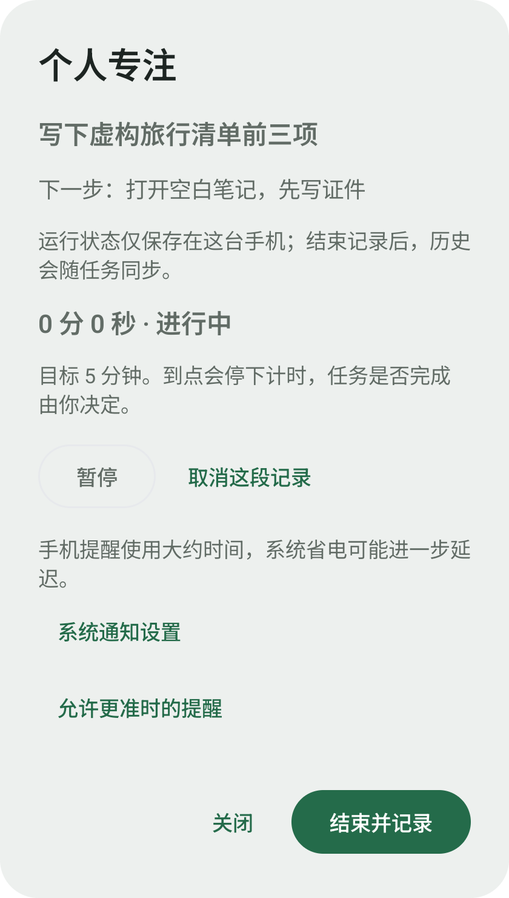
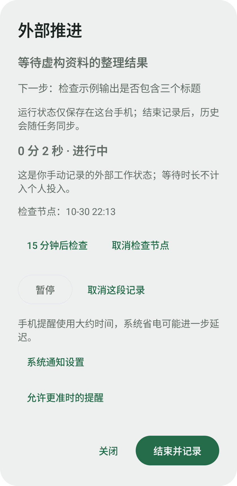
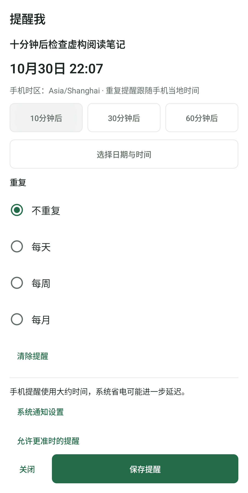
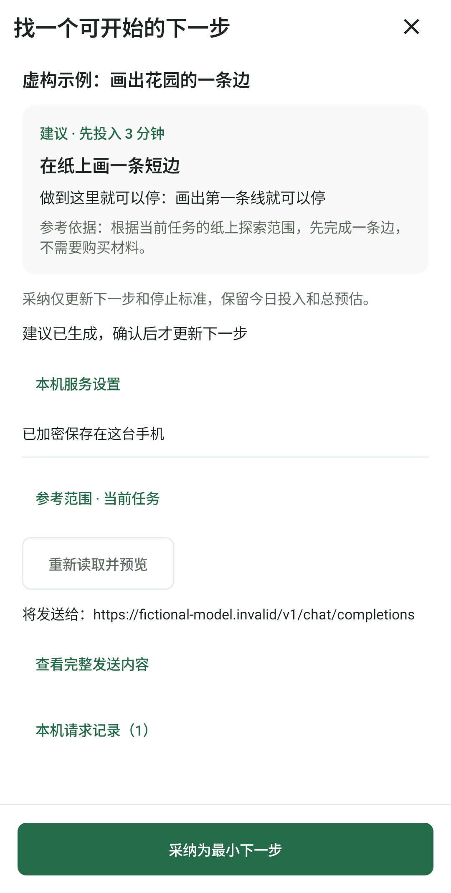

# Android 0.6.0：开始推进、及时回看、按需使用 AI

0.6在想法探索、今日规划和最小下一步的基础上，补上手机里的实际推进、系统提醒、有前情的AI和本地回看。主要操作从具体任务进入，首页保留清楚的列表。

## 专注与外部推进

打开任务更多菜单的「专注 / 外部推进」。个人专注可选择5、10、15、25分钟或自定义时长，支持暂停、继续、结束记录与取消。到点只停止这一段计时，不会擅自完成任务。进行中的任务在今天列表里提供暂停和继续，所有本机运行项也可以从「本机推进」入口找到。

同时可以记录多个外部任务，例如等待另一台机器上的AI或训练任务。Pare只记录你选择的开始、暂停、结束与检查节点，不声称能管理那些AI。外部等待时间单独统计，不加入个人用时。

运行状态保存在这台手机；完成后的推进记录可通过既有同步同步到Mac。重新打开应用可以恢复同次开机期间的状态；设备重启或时钟证据不可靠时保守暂停，不能确认的时长不计入。结束操作遇到中断后使用稳定记录ID重试，避免重复记账。

## 手机提醒

更多菜单的「提醒我」支持10/30/60分钟后、自选日期时间、每天/每周/每月重复，以及清除提醒。也会安排已有今日时间块、个人专注目标和外部检查节点的提醒。任务提醒与重复周期跟随手机当地时区，日历计划沿用计划时区。

通知可以打开对应任务、稍后10分钟或关闭；锁屏公开内容使用通用提醒，不展示任务标题。完成、删除、改期以及处理过的提醒不会因普通同步重复弹出。

第一次需要在相应面板开启系统通知。未允许精确闹钟时会明确提示使用大约时间；系统省电、强制停止应用等仍可能影响送达，不能把保存了时间等同于系统保证准时提醒。实现依据见Android官方的[闹钟机制](https://developer.android.com/develop/background-work/services/alarms)、[通知权限](https://developer.android.com/develop/ui/compose/notifications/notification-permission)与[通知行为](https://developer.android.com/develop/ui/compose/notifications/create-notification)。

## 有前情的 AI

点顶部「AI助手」选择任务，或从任务菜单直接进入。首次在连接设置填写HTTPS兼容接口地址、模型名和密钥；Mac上的密钥不会自动复制到手机。

1. 默认只引用当前任务。需要时，明确附带相关想法、历史、目标或已确认偏好。
2. 查看将发送的内容，再主动生成一个2–5分钟可开始的建议。
3. 检查下一步、停止标准和理由，确认后才更新任务。建议时长供参考，不会覆盖总估时或已安排的个人/检查投入。
4. 采纳后可以撤销；若相关内容后来改变，撤销会停止以避免覆盖新修改。继续下一轮时可以保留已采纳内容，再获取新的建议；只保留最近一轮撤销入口。

密钥、配置和最多12条原始输入/输出记录在手机本机加密保存，可以查看或删除，不进入内容同步。请求有时长与大小限制；服务报错、返回格式不合要求或任务已改变时不会自动修改任务，也不自动重试。AI界面保留系统截图保护。

## 本地回看与轻提示

顶部「回看」汇总近7天实际记录的完成、个人专注、外部推进与卡点，不把估时当作成果。可以找到到了回看时间的想法，以及至少7天没有记录推进的任务。没有记录不代表没有做事，用户自行决定继续或暂放。

首页最多出现一条本地轻提示，可暂放一周，也可在回看页面关闭。正在本机推进的任务不提示停滞。这些判断在本机进行，不后台调用模型。

## 实际界面

| 个人专注 | 外部推进 |
|---|---|
|  |  |

| 手机提醒 | 建议先显示，参考按需展开 |
|---|---|
|  |  |

这些是隔离QA应用的实际窗口渲染，保留原始像素，使用虚构任务和假模型回复；没有真实密钥或个人资料。AI页面的系统截图保护仍开启。

## 验收范围

- 最终完整命令 `./android/build.sh testDebugUnitTest assembleDebug lintDebug connectedQaAndroidTest` 通过：169项单元测试、9条模拟器流程，0失败、0跳过。
- lint 0错误、23项非阻断的依赖版本/KTX建议；APK签名校验通过。
- Mac现有解码器通过Kotlin生成的虚构载荷，包含个人会话、外部会话和重复提醒。
- 通知点击前后确认同一Activity实例和taskId，收尾没有残留页面；专用通知小图标验证透明背景与可见笔画。
- 3个子系统实现代理交叉审查，并由独立代理完整复核；修复时区切换重复通知、失败暂放反馈、陈旧完成与多轮AI采纳等边界。

本轮使用独立QA包和虚构资料，模型请求使用假传输。单元测试覆盖状态持久化、暂停/重启、结束重放、权限与通知去重、时区变化、AI授权上下文、错误响应、陈旧采纳和条件撤销。设备流程覆盖真实Compose页面、Android Keystore、系统通知及点击跳转。

通知测试会验证系统闹钟登记，并推进测试时间触发实际通知、检查点击定位；没有用这次流程宣称实体手机的10分钟后台送达已经验收。真实模型服务、实体手机厂商省电限制、跨设备同时运行协调和正式签名上架仍需分别验证。APK保持开发测试签名。
