# Android 0.7.0：更清楚、更柔和的界面

这次统一了主页、想法工作台、任务编辑、今日规划、卡点支持、专注、提醒、AI、账号与回看的视觉层级。继续围绕Pare的想法到行动流程，优先让当前内容和主要操作容易找到。

## 主要调整

- **颜色**：柔和浅底与白色内容区分层，深绿用于主操作，暖金突出重点和选中状态。深色主题同步调整。
- **文字**：正文16sp，辅助文字13sp；标题、字段、说明区分权重。专注时间使用36sp等宽数字。
- **圆角与间距**：控件8dp、输入12dp、内容区16dp、弹层24dp；按同组与不同组设置间距，减少杂乱分隔。
- **主页**：连续的任务分组、圆形完成控件、安静的次级入口，以及更明显的添加任务动作。标准字号的360×800dp视口仍能完整显示6条任务。
- **具体页面**：专注突出时间和下一步；提醒使用紧凑的重复菜单；AI建议优先展示，参考、连接和原始内容按需展开；想法的问题与探索时间线更明确。

## 前后对比

| 主页：优化前 | 主页：优化后 |
|---|---|
| 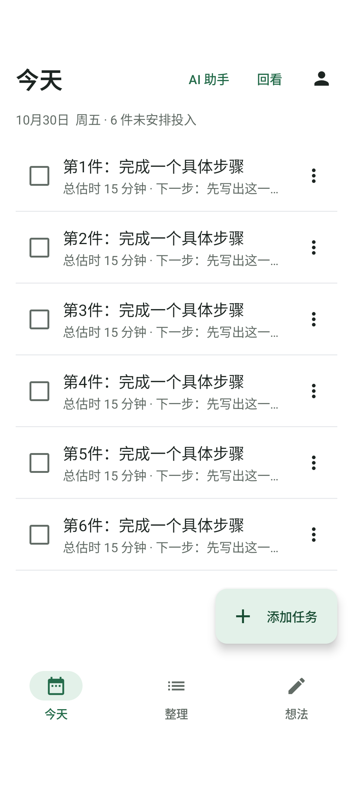 | 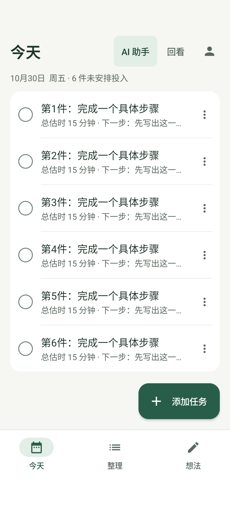 |

| 专注：优化前 | 专注：优化后 |
|---|---|
| 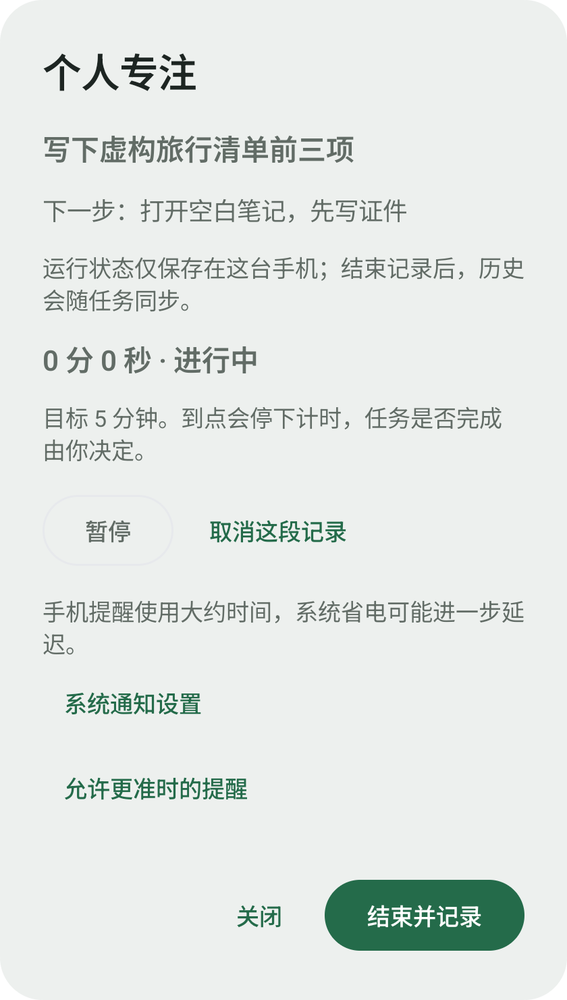 | 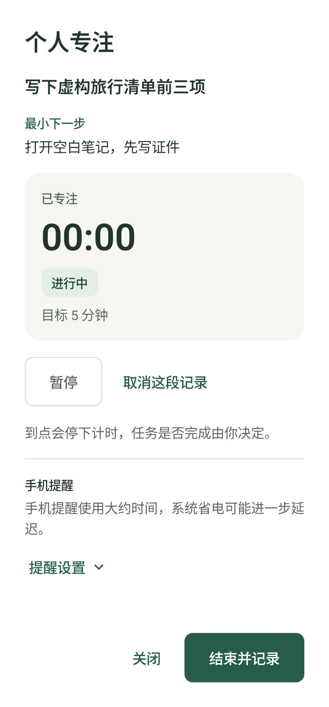 |

## 其他实际页面

| 深色主页 | 想法工作台 |
|---|---|
| 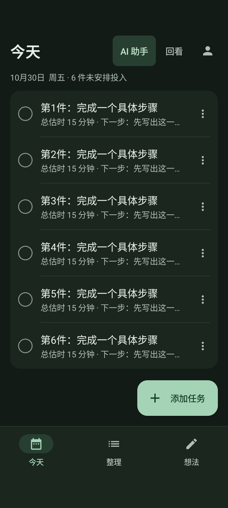 | 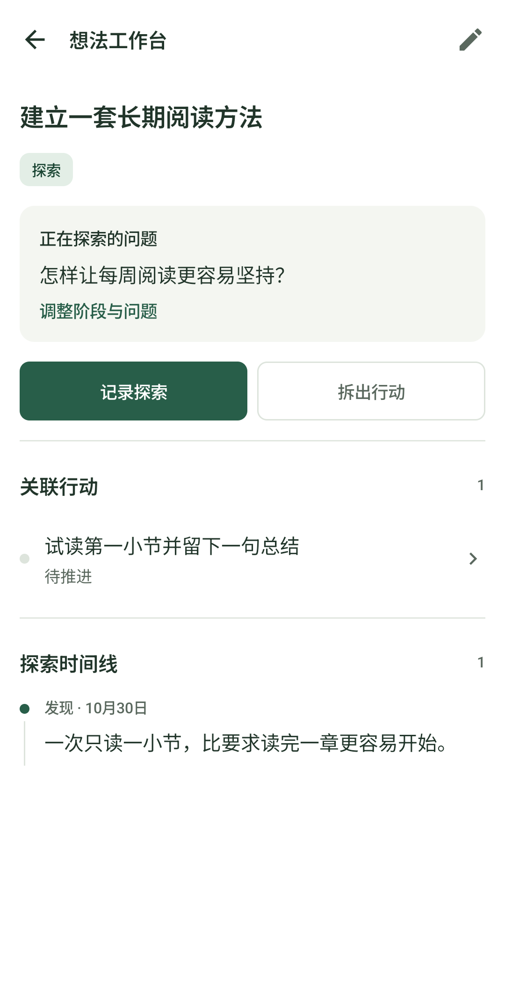 |

| 提醒 | AI建议 |
|---|---|
| 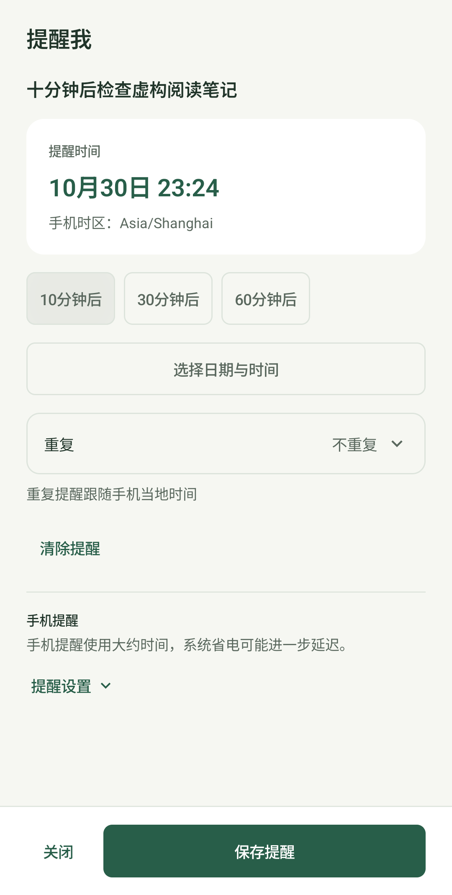 | 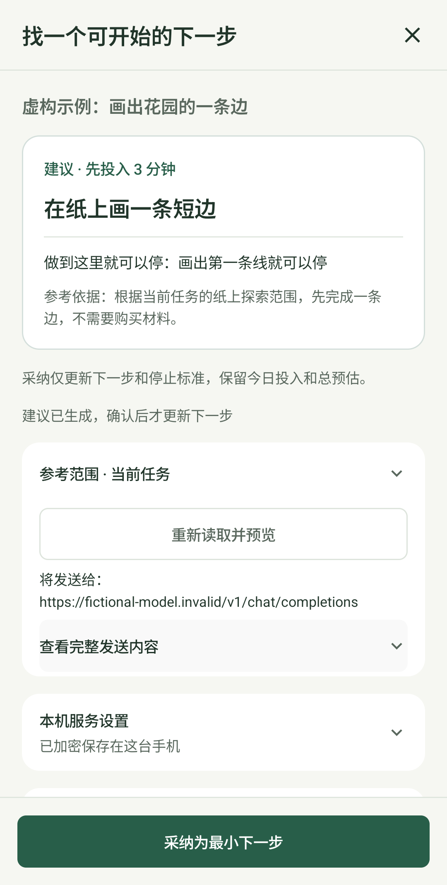 |

| 账号与同步 | 本地回看 |
|---|---|
| 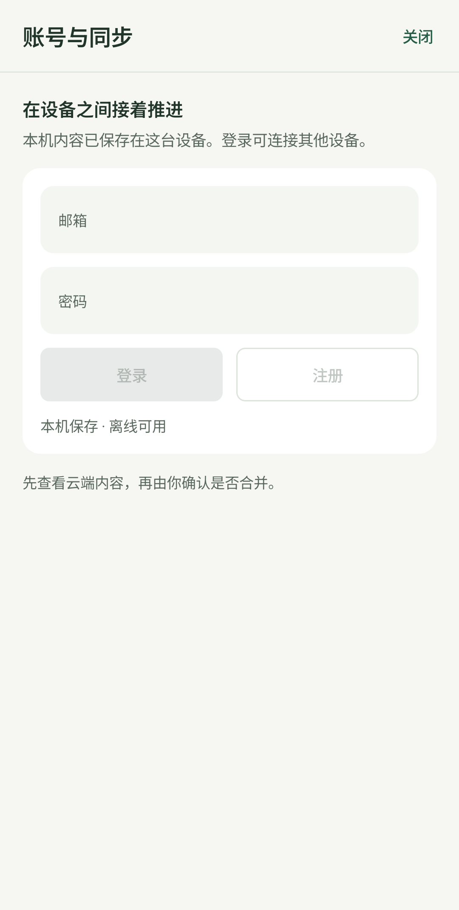 | 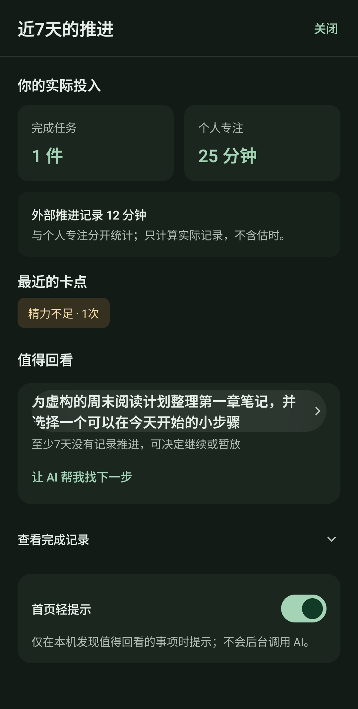 |

以上为隔离QA应用的实际渲染，使用虚构资料和假模型。图片保留原始像素，不用生成图替代界面。窗口截图与固定视口截图尺寸不同，画面比例按实际窗口保留。

## 大字体与验收

| 系统字体缩放1.6：规划 | 系统字体缩放1.6：卡点支持 |
|---|---|
| 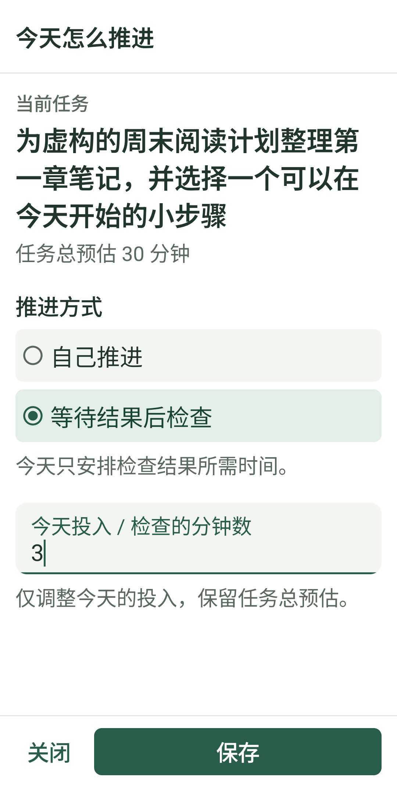 | 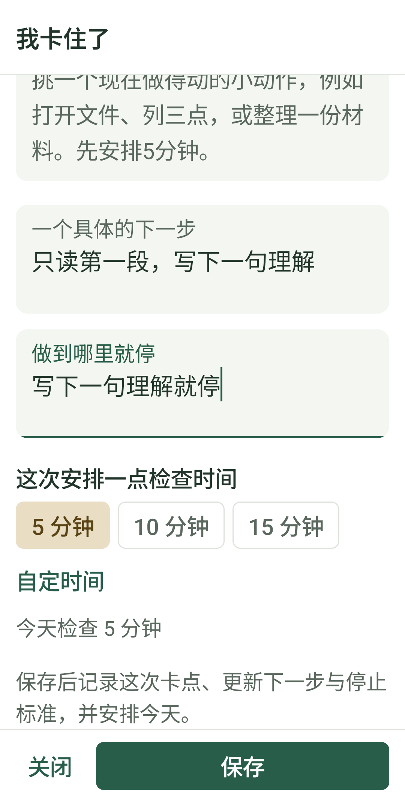 |

卡点图展示滚动至输入区的状态，顶部标题与底部操作保持可达。另有[大字体编辑器](../images/android/v0.7/editor-large-font.png)。

- 171项单元测试通过；其中配色检查覆盖明暗主题的正文、辅助文字、主按钮和重点区域，主要文字配色对比度至少4.5:1。
- 11条模拟器流程通过；圆角收尾后定向复验2条推进/提醒流程，再复验3条真实字体配置的编辑/规划/卡点流程，均无失败或跳过。
- 大字体检查从真实Dialog的文字排版结果读取缩放比例，不依赖外层预览参数。见[规划字体指标](../images/android/v0.7/visual-font-scale-planning.json)、[编辑器字体指标](../images/android/v0.7/visual-font-scale-editor.json)。
- 测试检查关键操作至少48dp、长标题换行、键盘与滚动下保存可达，以及保存失败后草稿保留。
- [列表实测](../images/android/v0.7/density-metrics.json)：第一条任务起点约143dp，6条任务完整可见。
- 独立代码审查与实际截图复核已完成。业务、同步与模型调用规则沿用0.6；本轮不使用真实账号或模型服务。

安装包为 `Pare-Android-0.7.0-debug.apk`，可以覆盖同签名旧测试包并保留数据。仍是开发测试版，未正式上架；实体手机及厂商系统表现需继续实测。
