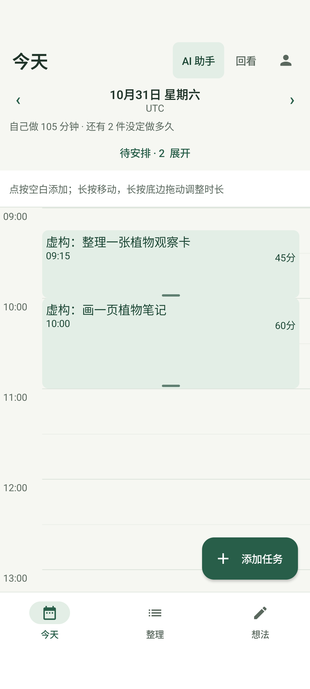
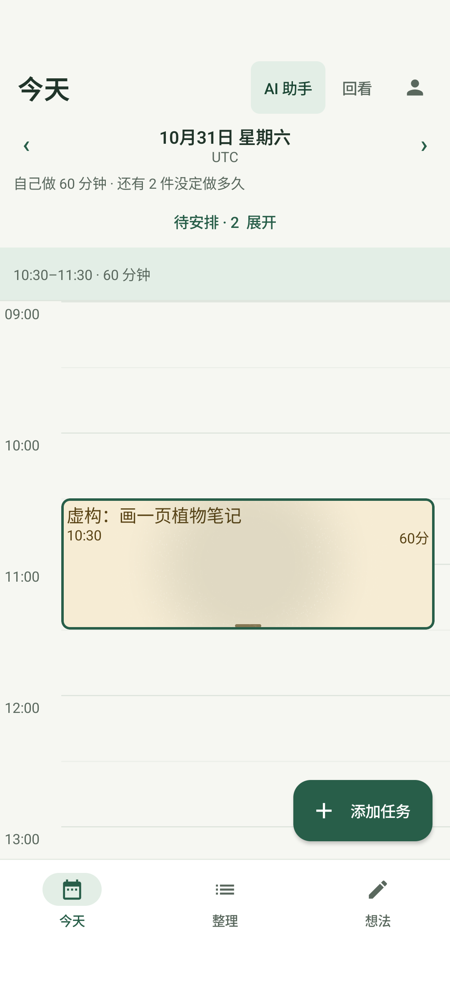
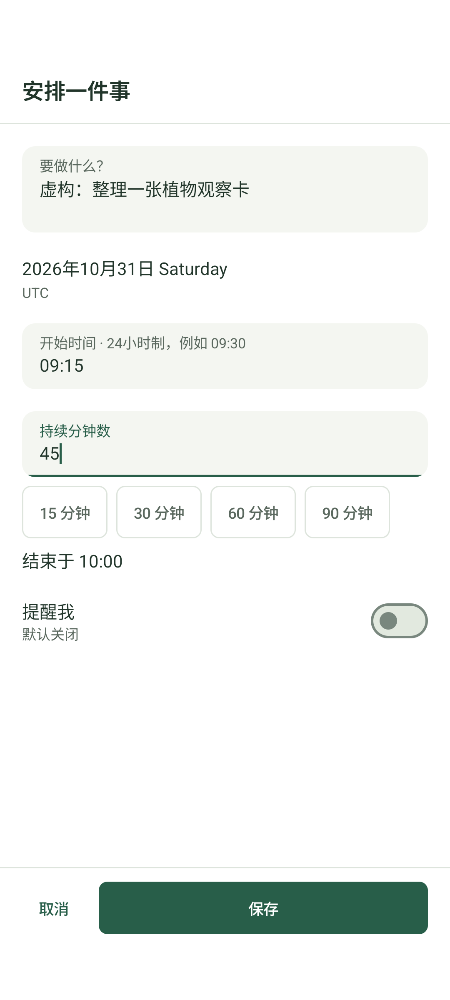

# Android 0.8.0：直接在时间轴安排事情

「今天」现在是一条可操作的时间轴，任务菜单缩成三个常用入口。原来的「外部推进」改为更直观的「等待结果」，默认进入自己专注，已经交给AI或别人处理时再展开等待记录。

## 怎么使用

| 想做什么 | 操作 |
|---|---|
| 先记下来 | 右下角「添加任务」，只写标题即可；保存到当前所选日期的「待安排」，随后自动展开 |
| 在某个时间添加 | 点时间轴空白位置，填写标题；开始时间自动带入，时长默认30分钟，提醒默认关闭 |
| 改变任务顺序 | 展开待安排，长按任务上下拖动 |
| 安排已有任务 | 从待安排长按拖进时间轴，查看预览，松手保存 |
| 改开始时间 | 长按时间块主体，上下拖动 |
| 改时长 | 长按时间块底边手柄，上下拖动；常规调整以15分钟为步长，最短1分钟 |
| 精确调整 | 点事项后选择「调整时间」，直接输入开始时间或分钟数；也可移回待安排 |
| 撤销一次拖动 | 点保存反馈中的「撤销」；安排已被再次修改时不会覆盖新内容 |
| 查看别的日期 | 用日期两侧箭头；需要时点「今天」回到当天 |

时间块按分钟比例排布。很短的事项保留最小点击高度，以文字给出准确时长；重叠事项并排展示，较多并排事项可左右滑动。跨午夜事项会在涉及的日期显示。已完成事项保留在日程中。拖动开始时间限当前起始日期；跨午夜延续块可调整时长，要改开始时间可回到起始日期或点「调整时间」。暂不支持把已有时间块直接拖到另一日期。

## 入口更简单

任务菜单保留「安排时间」「开始专注／查看进度」「任务详情」。AI、提醒、拆小下一步、今天投入和重点等放在任务详情中按需展开。编辑了文字时，会明确提示先保存，再继续相应操作。

「等待结果」是手动记录等待AI、另一台机器或别人处理的过程，可以提醒自己回来检查。它不表示Pare已经连接或控制那些AI，等待时长也不计入个人专注。

## 实际界面

| 时间轴 | 拖动时先预览 |
|---|---|
|  |  |

| 直接安排时间 | 精简后的任务菜单 |
|---|---|
|  |  |

图片来自隔离QA应用的实际渲染，全部是虚构资料，保留原始像素。不是生成的效果图。

## 保存与验收

- 创建任务和安排时间一次保存；拖动过程中不写入，松手后才提交。
- 保存会检查拖动前的状态；其他设备修改、删除或产生冲突时，不静默覆盖。
- 今日重点及个人/检查计划摘要继续显示；摘要沿用已有计划口径，不当作已经完成的实际用时。
- 提醒打开后显示真实通知权限与入口；跨午夜提前提醒也参与安排。
- 旧版Mac未来日程会在编辑时原子迁移，保留其他字段；清理旧副本和撤销都经过回归检查。超过同步操作组上限时会明确拒绝，保留原数据。
- 208项单元测试、17条模拟器界面流程通过，0失败、0跳过；短事项缩短和截图收尾另定向复验6条时间轴流程。构建与lint无错误。
- 真正使用触摸事件验证创建、排序、拖入、移动、缩放、撤销；包括列表首行部分滚出视口后的准确落点、未来日期快速录入和提醒权限反馈。
- Mac现有解码器通过Kotlin输出的虚构日程载荷。本轮未使用真实账号重新执行双端网络同步，也未调用真实模型。

## 哪些仍未完整移植

Android仍未与Mac功能完全一致。长期目标和偏好编辑、多种AI规划工作流、完整搜索/归档/删除恢复，以及运行状态的跨设备协调仍有缺口。详见[功能覆盖核对](../android-feature-coverage.md)，不能把本轮时间轴完成理解为整个产品全部完成。

`Pare-Android-0.8.0-debug.apk`是开发测试包，可覆盖同签名旧版本保留数据；没有正式发布或上架。实体手机的厂商省电与通知行为仍需继续实测。
