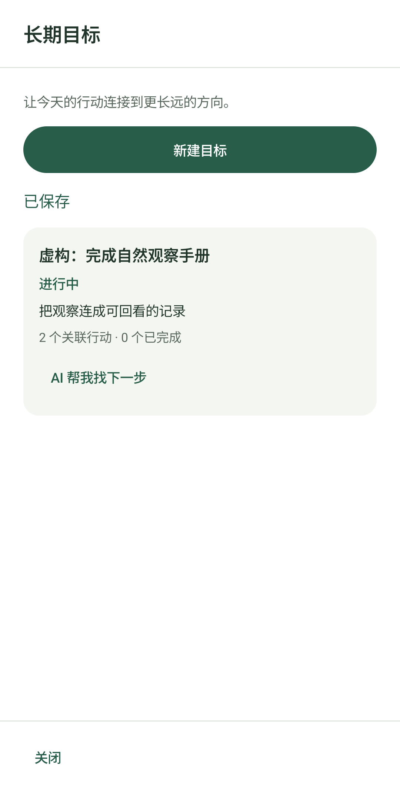
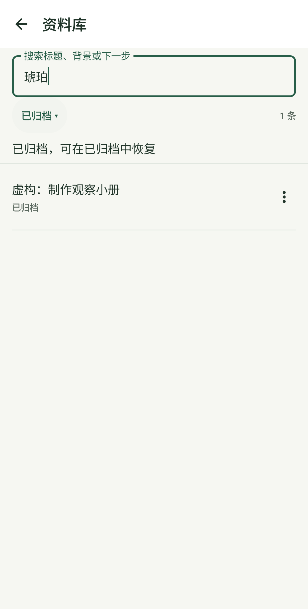
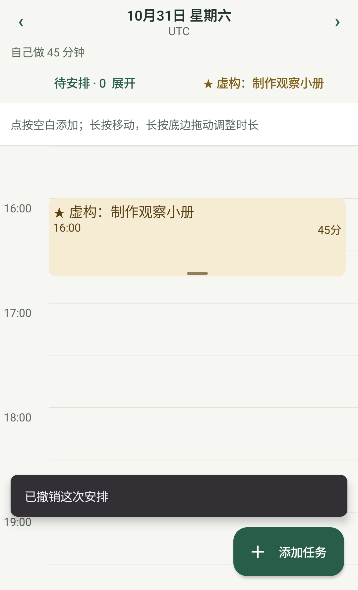

# Android 0.9.0：从安排今天，到持续推进

本地开发验收版，配套 Mac 2.14.0。云端运行状态接口已部署；应用商店及公开 GitHub Release 尚未发布此版本。

## 从这里开始

| 想做什么 | 在哪里操作 |
| --- | --- |
| 把一件事挪到另一天 | 在「今天」长按时间块，拖到前一天/后一天；点时间块编辑，可选任意日期。保存后可撤销，返回原日期并定位原任务。 |
| 找回过去的内容 | 右上角「更多 → 资料库」，搜索标题、背景或下一步；筛选归档、截止事项或本机回收站。 |
| 把大方向变成行动 | 「更多 → 长期目标」记录方向，关联已有任务，或只创建一个起步行动。 |
| 让想法慢慢完善 | 打开想法，积累问题、发现和决定；管理关联行动与下次回看日期，不必马上变成任务。 |
| 让 AI 帮忙 | 顶部 AI 先帮你安排当前选择的一天；想法、随手记和目标内也有对应入口。先预览发送内容，生成后逐项采纳。 |
| 没动力开始 | 在任务的卡点支持中写下最小一步，点「保存并开始5分钟」；也可以只保存。 |
| 到点只做一小步 | 在任务详情设置行动触发：“到这个时刻，先做这个动作”。它与截止日期、普通提醒和日程安排分别设置。 |
| 看看计划是否合适 | 「回看」按需展开八周趋势、象限完成与估时校准；缺少记录时会说明，不编造统计。 |

不必一次设置所有内容。先用「记下来 → 放进一天的时间 → 做五分钟」，需要回顾或长期方向时再打开更多功能。

## 管理与恢复

删除后，恢复资料会留在这台手机的回收站，关闭再打开也能找到。如果原记录已经同步或改变，会明确提供恢复副本，避免覆盖新内容。回收站最多保留100项或2 MB；超过30天只提示清理，不自动删除。删除资料的同步与本机恢复资料分开处理。

目标和偏好都是你明确写下的内容。AI 可以在你允许的范围内参考它们，但不会把一次建议自动当作长期习惯；密钥和原始请求历史仍在手机本地加密保存。

 

截图来自隔离 QA App 的虚构资料，保留1080像素原始宽度，可点开查看。

## 多台设备一起用

Android「更多 → 设备运行状态」和 Mac「设置 → 同步」中分别开启运行状态共享。需要使用同一账号并已确认内容同步。开关默认关闭，按设备保存。

共享的是任务标识、运行状态与计时摘要。另一设备离线后，旧报告会过期并显示无法确认；开始专注时，如有新鲜的其他设备运行记录，会先提示确认。各设备继续管理自己的计时，Pare 不会控制你在其他机器使用的 AI。

Mac 配套包仅已构建，未自动替换本机正在运行的版本。旧 Mac 版本没有这项状态共享功能，需要安装配套版本后才能参与。

## 验收范围

- Android：324项单元测试通过；构建成功，Lint 0错误、26条非阻断警告和1条提示。29条不同模拟器界面流程完成验收。跨日表单用例修正日期控件的语义定位后，5条主界面流程重跑通过；其余24条已在全套运行通过。
- Mac：343项测试通过，2.14.0 Release构建与签名检查通过。
- 云端：SQL权限/隔离/序号回归通过；18项真实HTTPS检查通过，临时账号、会话和测试资料已清理。
- 真实云端检查使用两个独立Swift客户端模拟两种设备协议；不等同于安卓进程联网或实体手机双端验收。手机后台通知仍受设备厂商省电策略影响。
- AI采用可控的虚构服务回复验收；本轮没有发送真实任务或使用真实模型密钥。

详细边界：[功能覆盖](../android-feature-coverage.md)、[云端部署验收](../../backend/supabase/docs/presence-v1-acceptance.md)。
