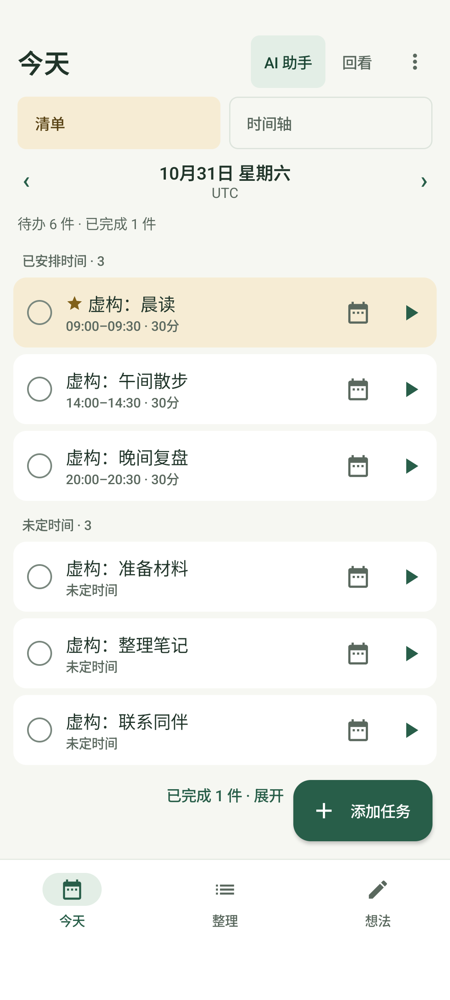

# Android 0.9.2：先看清一天，需要时再排时间

「今天」默认打开紧凑清单，早晚的安排放在同一列表中，不再为没有任务的时段留出大片空白。

- **清单：** 已安排时间的任务按时刻排列，未定时间的任务集中展示；已完成内容可展开回看。保留今日重点、完成、调整时间与开始/暂停入口。
- **时间轴：** 需要排时间时切换，继续使用点空白添加、拖动、缩放和跨日安排。两种视图共用所选日期，切换及旋转保留视图状态；回到时间轴保留原滚动位置。
- **保存提示：** “安排已保存”通常约4秒后自动消失，保留撤销和关闭按钮。使用系统无障碍延长提示时间的设置时，会遵循系统时长。

保存提示原来因带“撤销”操作而采用了框架默认的无限时长。本次明确设置短时显示，没有删去撤销能力。关闭提示只隐藏提示，不会取消已保存的安排。

跨午夜时段标注“前一天/次日”；同一任务有多段安排时可以分别选择编辑。清单按当前选中的日期取数据，不把未来日期误替换成今天。

## 验收

- 327项单元测试通过，包含所选日期、完成项、跨午夜、多时段和旧Mac日程的清单投影。
- 新增真实界面流程已验证：默认清单能同时看到六件虚构任务；切换模式和旋转保留日期/滚动位置；开始、暂停、继续可操作。
- 保存提示在不点击、不切页、不销毁窗口的情况下自动消失；撤销与手动关闭分别验证，保存数据仍保持正确。
- 截图来自隔离QA包的虚构资料。新增2条流程与既有14条相关流程完成验收；资料库测试修正菜单退出时的测试焦点竞争后，5条工作区流程复验通过。Debug构建与Lint通过（0错误）。

这是开发测试包，版本0.9.2。沿用已有debug签名，可覆盖安装；本次不修改云端协议或账号资料。
