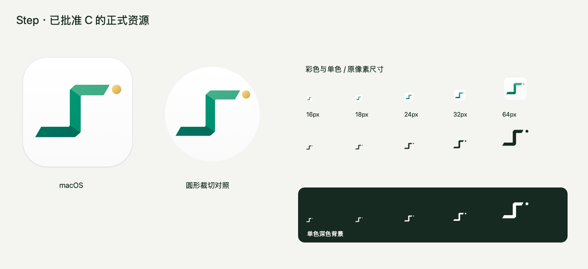

# Step 品牌升级（当前开发版）

Pare 更名为 **Step**：从想法，到下一步。Mac 2.15.0 / build 42，Android 0.14.0 / code 19。本页对应本地源码开发包，公开下载链接仍指向此前发布的 Pare 版本。

## 新名称与图标

采用用户确认的 C 方案：白底、绿色折面 S、两端斜切、带小圆角的切角转折和前方金色圆球。上升结构表达阶梯；连续路径和目标点表达逐步接近目标。

App、设置、提醒及桌面组件显示名称统一为 Step。四象限、想法孵化、今日规划、最小下一步和已有 AI／同步流程沿用。

## 原有数据继续使用

这是现有应用的品牌升级。Mac bundle ID、Android applicationId、资料库路径、同步格式、凭据服务和后台任务身份保持原值。Mac 数据路径中保留 `Pare` 是为了继续读取已有记录，不需要手动迁移或重新注册账号。

源码构建输出为 `dist/Step.app`；内部可执行文件仍为 `Pare`。升级时只保留一份正式安装。若正在专注计时，先完成这一段再退出旧进程；退出行为本身会结束并记录该段专注。

## 图标适配与验收范围

彩色矢量、Mac 图标和 Android adaptive 图层沿用 C 轮廓。Android 图形包含圆球，通过中心66dp圆形安全区检查。单色小图将上端轻微收短，避免栅格化后与圆球相接；彩色图标不变。

- Swift：343 项测试通过；Mac release 构建、plist 和本地签名通过。
- Android：374 项单元测试通过；APK 构建通过；Lint 0 errors、101 warnings、1 hint。
- Android 原生模拟器验收：10例中9例通过、1例因启动器支持条件预期跳过，0失败。包括通知原生绘制及点击路由、实际启动器添加组件确认/放置、计时恢复和组件操作。初次运行的外部截图输出目录权限问题在去掉可选输出参数后消除；最终运行未导出截图。
- Mac 使用实际菜单栏绘图方法及最终PDF做离屏原生检查：普通图标2个独立形体、提醒状态3个独立形体；提醒点没有擦除主形像素。证据：[普通](../brand/step/production/menu-normal-2x.png)、[提醒](../brand/step/production/menu-attention-2x.png)、[检查结果](../brand/step/production/menu-native-check.txt)。这不等同于已解锁桌面上的交互验收。
- 最后单色缩微修正的 Android 通知单例复验通过：24px 原生位图在 alpha > 0.25 下恰有两个八邻接分量，S 与圆球分离；通知隐私与点击路由的既有检查同时通过。其余行为代码不变，未重复整组验收。
- 没有修改后台服务或重新执行云端／真实模型服务验证；没有物理 Android 手机验收。

正式资源可通过 `swift Scripts/render-step-brand.swift` 重建。设计依据与批准记录见 [已批准的 C](../brand/step/approved-c.md)。

## 本地更新状态

当前机器已安装 Step Mac2.15.0，安卓模拟器已覆盖更新为0.14.0；原有记录数量与标识摘要核对一致。Mac应用目录只保留Step入口，更新后确认只有一个主进程，Finder中的名称和C图标已确认。

2026-11-02用户解锁并打开整理后，补完桌面交互验收：主窗口被识别为Step，四象限与既有内容正常呈现；设置入口能打开「Step 设置」，通知权限显示已开启，原快捷键仍可见；关闭设置后正常返回整理。本轮未编辑任务、修改配置或公开真实数据截图。此结果确认本次品牌升级的主窗口与设置往返，不扩大为全部功能或性能验收。未向GitHub或应用商店发布。
