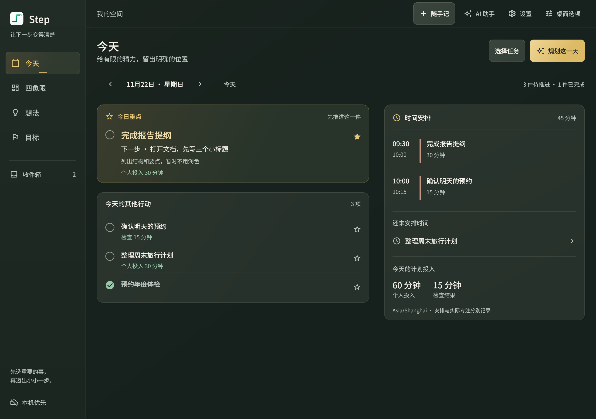
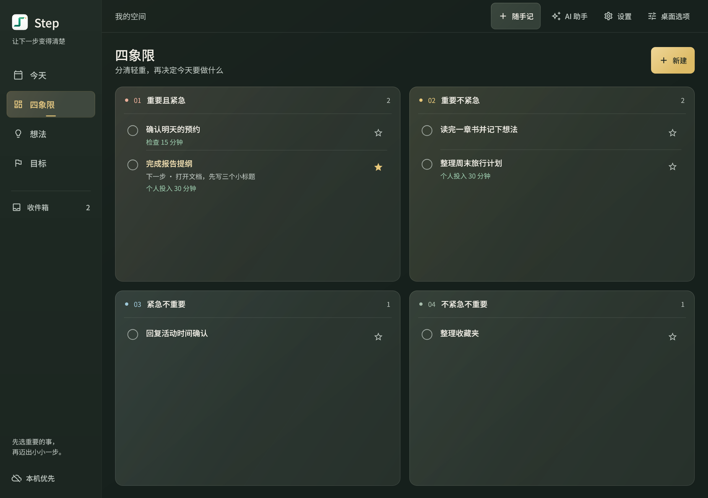

# Windows 界面预览

这一版延续 Mac 的深绿暖金风格，另提供协调的浅色模式。柔和渐变、细边缘高光和轻阴影区分工作区、重点与输入区域；普通行动集中在清楚的列表中。按钮提供悬停、按下和键盘焦点反馈，文字和图标保持统一比例。

## 今天

## 四象限

## 浅色模式

这些图片来自 Windows 测试环境中真实界面组件的离屏渲染，使用与 Mac 演示相同的一组虚构任务；不包含真实用户资料，也不是系统窗口/物理电脑截图。上图按 2 倍像素密度直接绘制，逻辑窗口为 1280×900，原图为 2560×1800，没有插值放大。

另可查看[普通密度](../images/windows/visual-review/dark-1280-today.png)、[窄窗口](../images/windows/visual-review/dark-960-today.png)和[完整步骤历史](../images/windows/visual-review/dark-1280-2x-task-history.png)。

本版 [Windows 构建验证](https://github.com/Zita-Go/Pare/actions/runs/45016498886)通过：安装和已安装程序自测、共享核心294项、桌面40项测试均成功。桌面测试包含8条界面工作流、6组深浅/宽窄/像素密度检查，以及按钮交互反馈检查。Windows个人电脑的中文输入法、系统标题栏、系统缩放切换、托盘和系统通知仍需实机验证。

安装包已生成但暂未发布，等待这轮界面确认。系统级注意力检测按约定留待后续。
