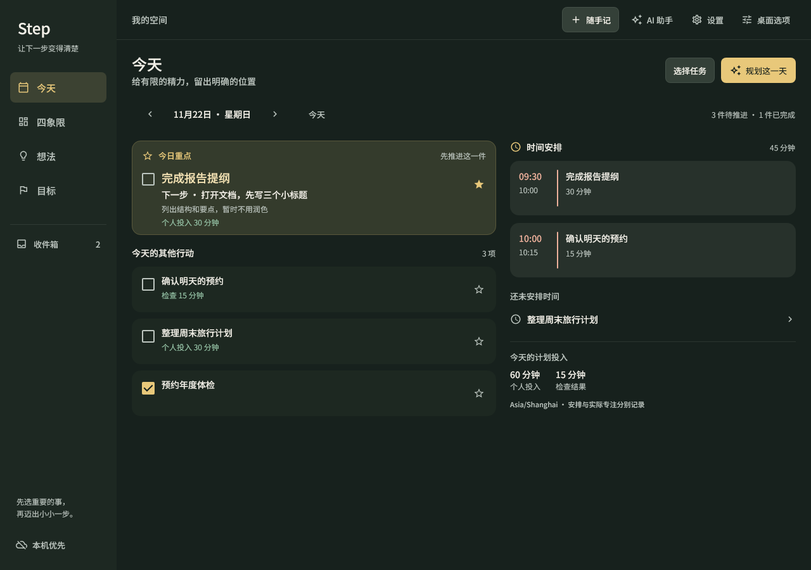
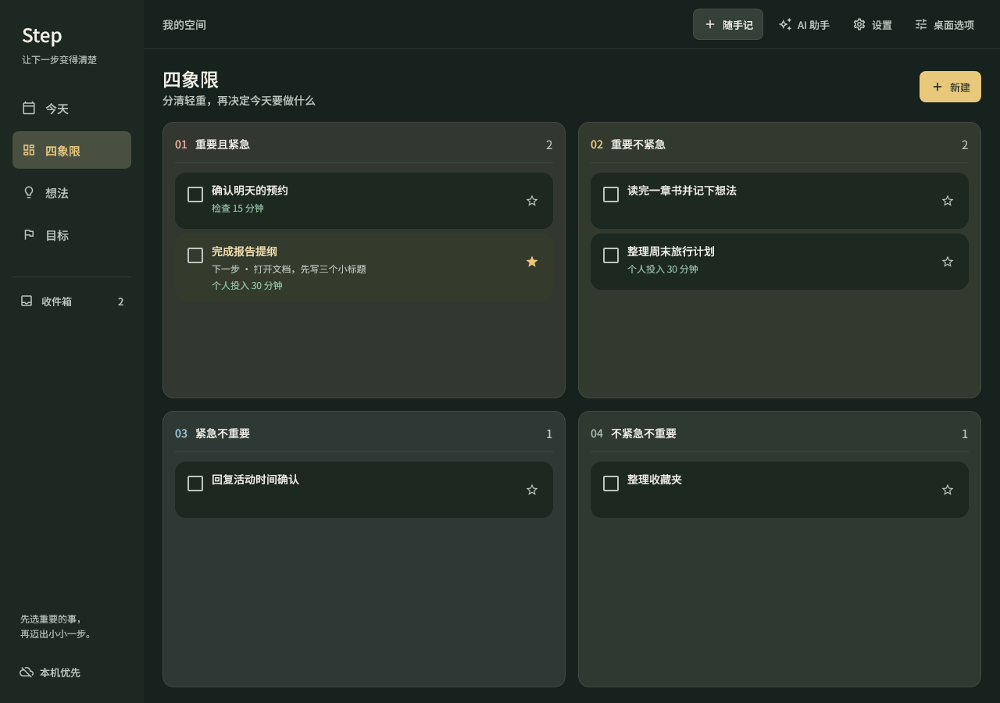
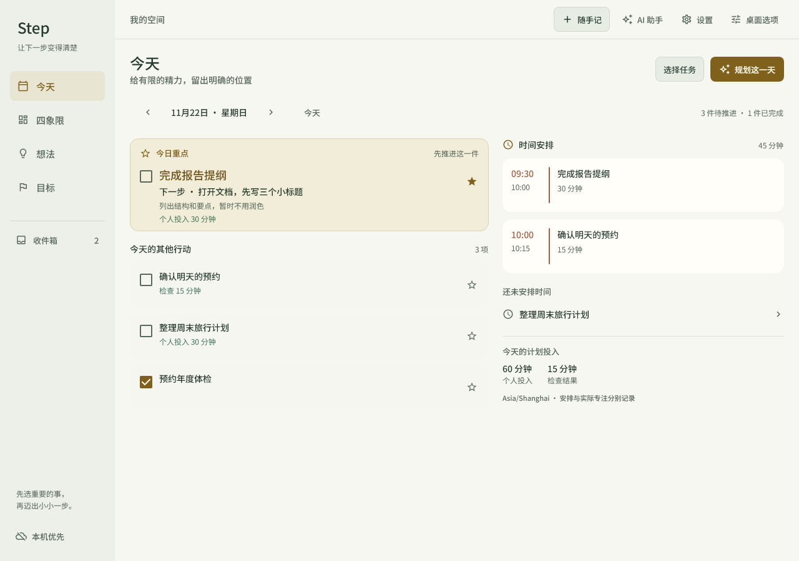

# Windows 界面预览

这一版延续 Mac 的深绿暖金风格，另提供协调的浅色模式。界面使用随应用分发的中文无衬线字体，并统一按钮、卡片、图标与弹窗层次。

## 今天

## 四象限

## 浅色模式

这些图片来自 Windows 测试环境中真实界面组件的离屏渲染，使用与 Mac 演示相同的一组虚构任务；不包含真实用户资料，也不是系统窗口/物理电脑截图。

本版 Windows 构建、安装及已安装程序自测通过；共享核心294项、桌面31项测试通过，后者包含7条真实界面工作流与4组深浅/宽窄布局检查。Windows个人电脑的中文输入法、系统标题栏、高DPI、托盘和系统通知仍需实机验证。

安装包已生成但暂未发布，等待这轮界面确认。系统级注意力检测按约定留待后续。
