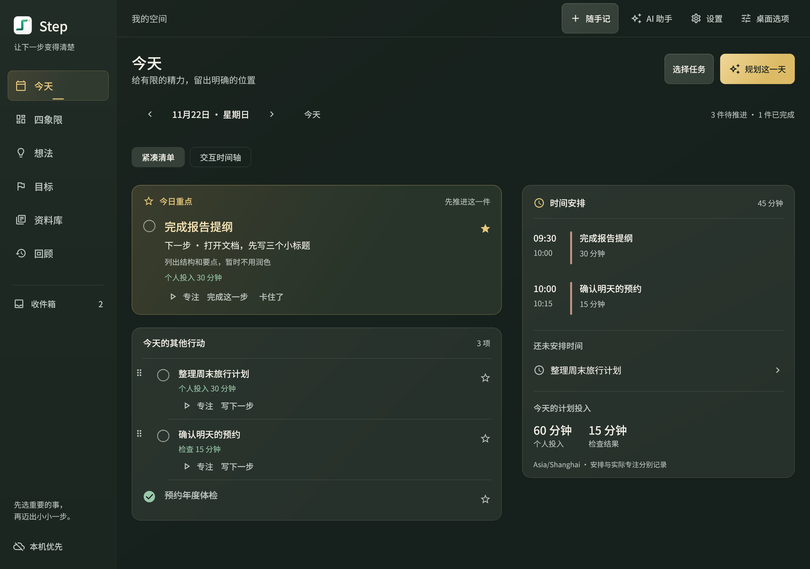
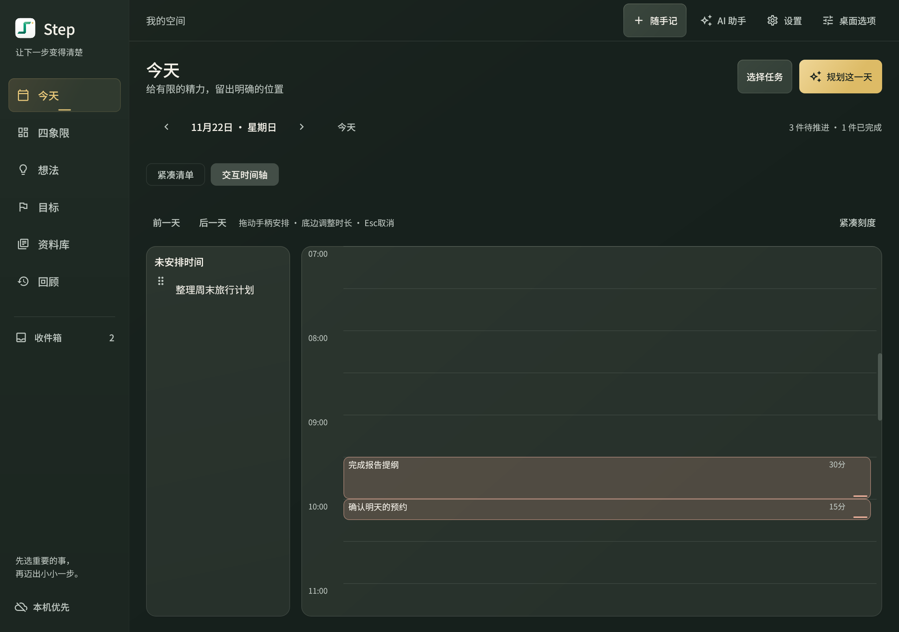
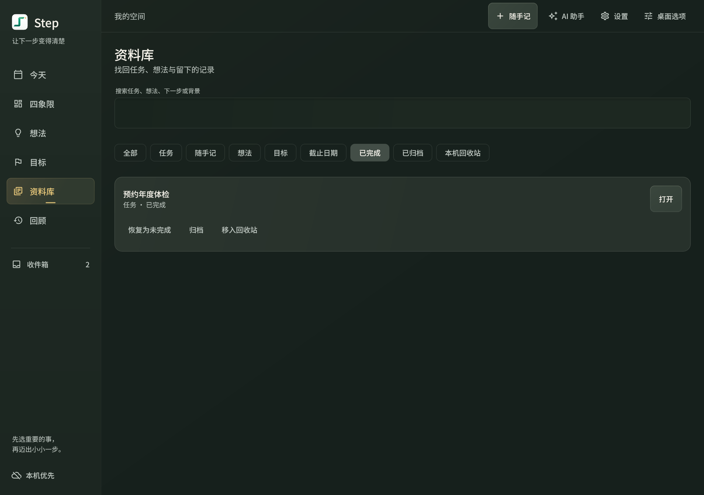
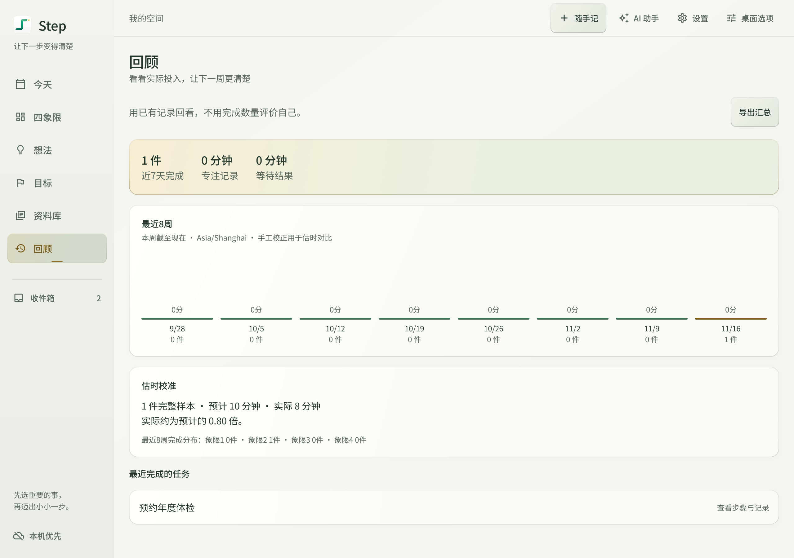

# Step for Windows 0.2 使用说明

当前下载请前往 [Windows 0.2.1](https://github.com/Zita-Go/Pare/releases/tag/windows-v0.2.1)。本页介绍 0.2 系列的日常功能；底部保留 0.2.0 构建的历史验证记录。

把想法接住，分清轻重，再从能开始的一步推进。Windows 版提供四象限、想法孵化、今日清单与时间安排，并与同账号的任务内容同步。

## 从哪里开始

| 想做什么 | 入口与操作 |
| --- | --- |
| 快速记下 | `Ctrl+Shift+Space` 打开随手记；保存到收件箱，稍后整理。快捷键可在桌面选项修改。 |
| 分清轻重 | 四象限拖动手柄可移动分类和调整顺序，右键菜单也可移动。误拖后可撤销。 |
| 安排今天 | 在今日清单选择任务、标记重点并调整顺序；需要排时间时切到交互时间轴。 |
| 拖动排程 | 从未安排区域拖入，拖动时间块改开始时间，拉右下角调整时长；拖向前一天/后一天可跨日移动。空白处可新建或选择已有任务。 |
| 开始或暂停 | 任务行、随手记和桌面小窗均有专注操作。可选5、15、30、60分钟，个人投入与等待记录分开。 |
| 完成下一步 | 点“完成这一步”留下步骤记录，整个任务继续保留；之后可以写新的下一步。 |
| 卡住时重新开始 | “卡住了”可记录原因和更小的行动；“只保存”不会启动计时，“保存并开始5分钟”会先保存再启动。 |
| 找回或整理旧内容 | 资料库支持关键词搜索、已完成、归档、截止与本机回收站筛选；任务可归档、恢复或移入回收站。 |
| 设置截止与估时 | 打开任务详情，填写截止、预计总时长及实际投入校正；它们与当天排程和提醒分开。 |
| 回看投入 | 回顾展示最近7天记录、8周趋势和估时对比；没有记录时不会替你推算。 |
| 使用AI | AI助手先预览参考内容，再明确发送和采纳。背景、反馈、确认偏好和原始历史有独立管理入口。 |
| 备份与恢复 | 设置→本机与备份选择文件，预览后再导入。也可预览上次导入前的恢复点；损坏资料另有自动备份恢复入口。 |
| 留一个桌面入口 | 桌面选项或托盘菜单打开 Step 桌面小窗，可查看当前推进与下一步、记下、暂停或继续。 |

## 可选的 Windows 能力

设置→Windows中可开启登录自启、可操作通知、退出后的已安排事项提醒，以及自动检查更新。下载和安装更新仍需明确点击，安装前会校验文件并处理未保存草稿。

本地注意力提醒与浏览器增强默认关闭。增强模式只把白名单前台浏览器的窗口标题转换为进程内临时摘要；不保存标题原文、网址或浏览历史，不上传观察信号。它只能发现切换模式，不能判断你是否在认真工作。提示有冷却、每日上限和暂缓操作。

本地轻提示会指出有依据的停滞任务、想法回看或超过自设投入提醒线的安排；点开后才调用你配置的AI。API密钥、原始请求历史和反馈由当前Windows用户加密保存在本机，不随任务内容同步。

## 使用边界

- 回收站记录保留在删除发生的设备；已同步的删除可恢复为副本，避免覆盖其他端的新版本。
- 恢复导入前内容会补回旧回收记录，同时保留目前的回收记录与恢复回执。
- 其他设备运行状态只是有时效的参考；暂停、结束和接管仍在原设备操作。旧版Mac/Android不会显示Windows设备，任务内容同步正常。
- 桌面小窗属于Step自身，不是Windows Widgets系统面板插件。
- 退出后提醒需要在设置中明确开启；关机、未登录、通知被系统关闭等情况下不保证准点交付。彻底退出会保守暂停本机计时，保留托盘可继续运行；彻底退出后不执行内容自动同步。
- 安装包面向Windows10/11 x64（Intel/AMD），尚无商业代码签名。

## 0.2.0 历史验证记录

[最终 Windows 验收](https://github.com/Zita-Go/Pare/actions/runs/45035586093)全部通过：共享核心295项、桌面99项测试；0.1.0升级到0.2.0保留任务、步骤历史及原始资料文件；已安装程序启动自测；系统自启/通知/计划任务注册、重复注册和清理。Mac360项、Android389项回归通过。安装包对应源代码 `71deb0d`。

[下载 Windows 0.2.0 历史构建](https://github.com/Zita-Go/Pare/actions/runs/45035586093/artifacts/14759747938)（GitHub登录后下载，包含EXE、MSI、免安装ZIP及SHA256SUMS）。它是构建产物，尚未创建正式Release。

当时尚未完成中文输入法、个人电脑缩放切换、多显示器、真实通知点击和锁屏交付检查。后续补充验证和修复请查看 [0.2.1 发布说明](https://github.com/Zita-Go/Pare/releases/tag/windows-v0.2.1)，不要将本段历史记录视为当前版本的验证结果。

## 界面预览

以下为Windows测试环境中真实组件的2倍像素密度离屏渲染，使用虚构任务，不是物理桌面截图。图片来自0.2的Windows验收构建，原图未经插值放大。

